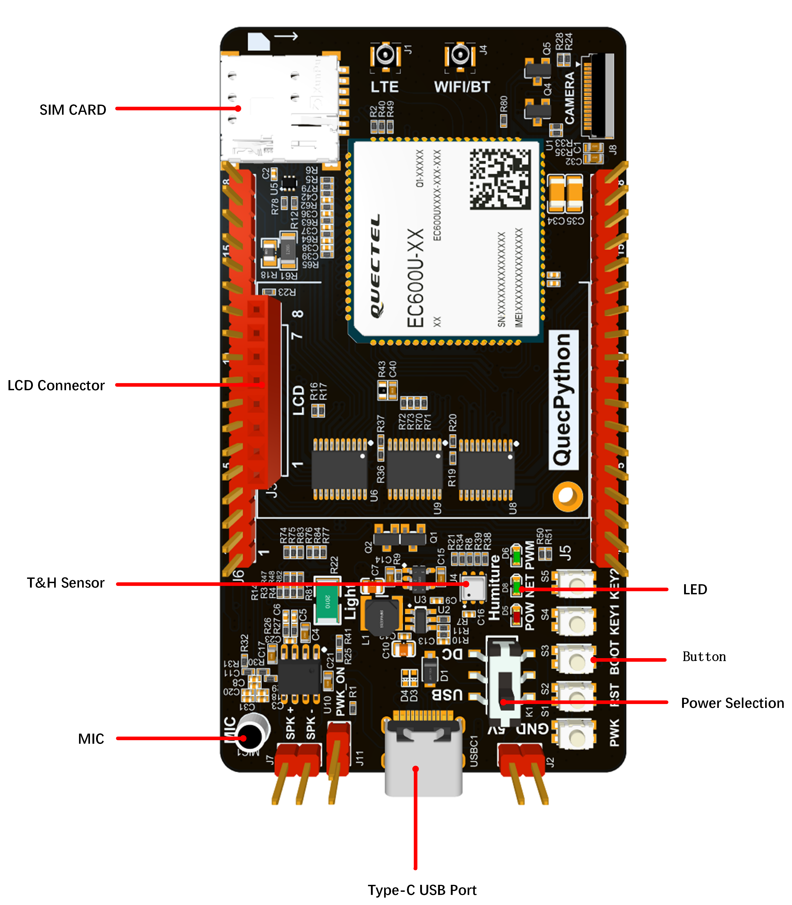
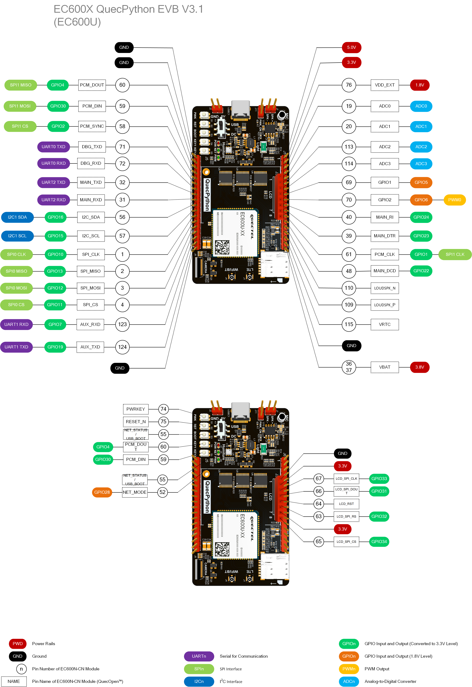
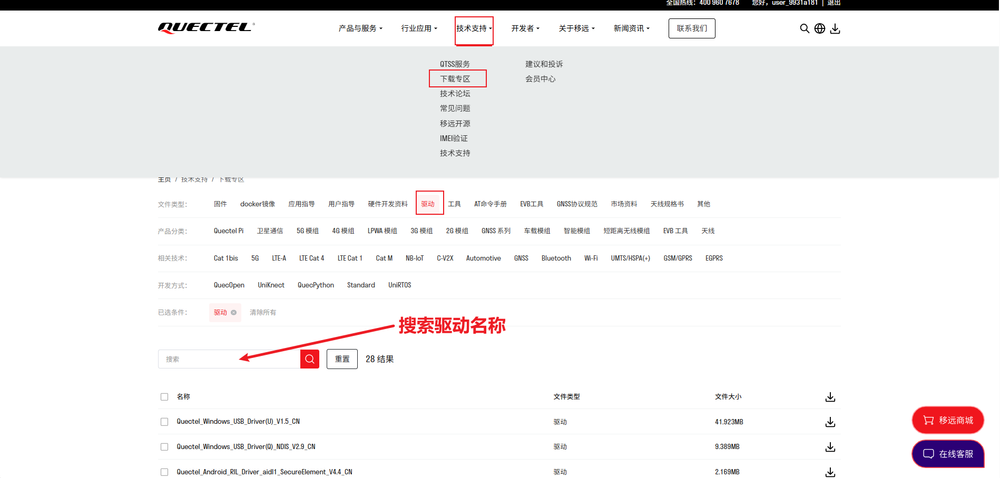
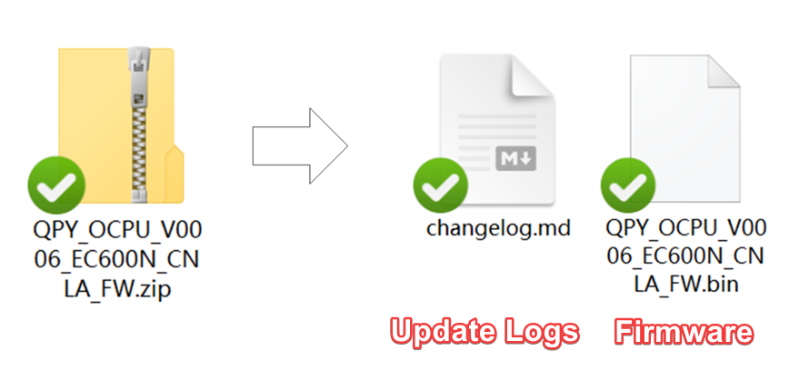
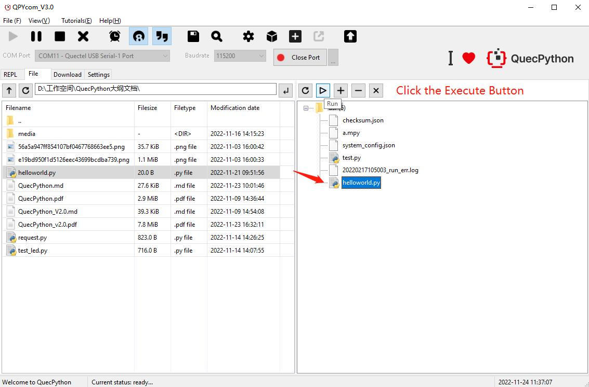
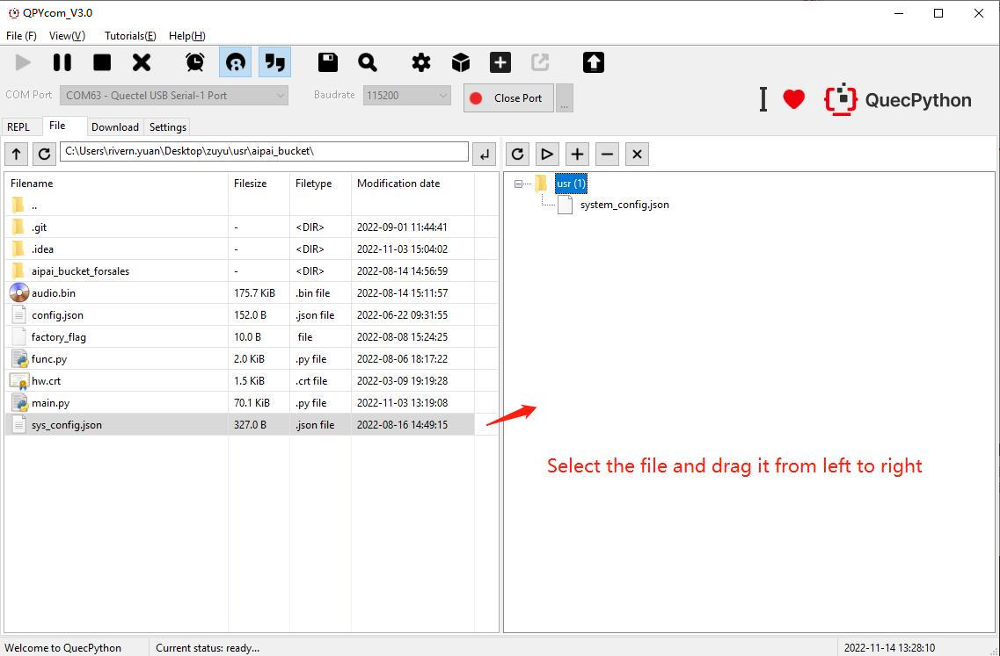
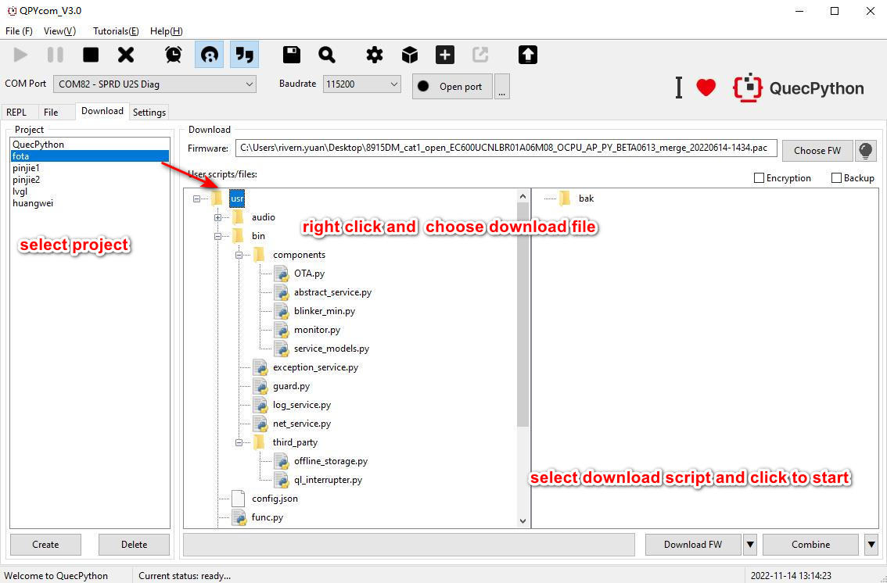
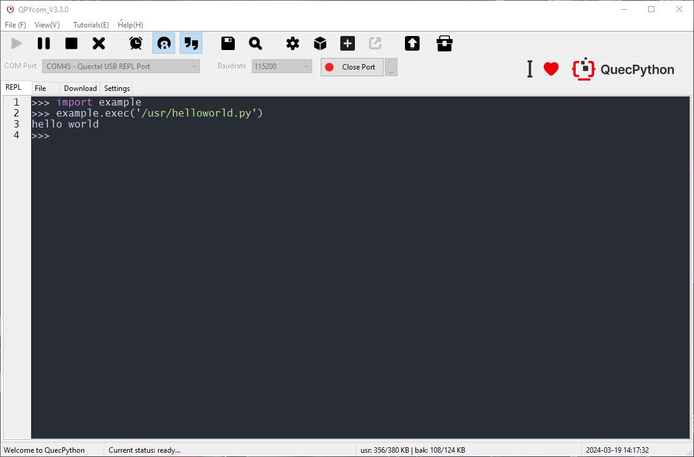

# EC600X Development Board Introduction

## Quick Start

Supported module list

- EC600N-CN

- [EC600U-CN](https://www.quectel.com.cn/product/ec600u-series)

- [EC600M-CN](https://www.quectel.com.cn/product/ec600m)

## Feature List

### Basic Overview

The QuecPython_EC600X_EVB development board is a compact, portable "pocket-sized" development board built specifically for QuecPython. Despite its small size, it is rich in features, including a temperature and humidity sensor, SIM card slot, LCD interface, photoresistor, MIC, and other components.

The development board currently uses EC600U as the main control module and is equipped with a Type-C interface. Developers only need one USB Type-C cable to start working with the board.

### Functional Description

The main components and interface layout of the development board are shown in the figure below.



## Document Downloads

- [EC600X_EVB_SCH](https://developer.quectel.com/wp-content/uploads/2024/09/EC600X_EVB_V3.2-SCH.pdf)

## Development Board Resources

### Development Board Interfaces

**J5 Pin Header Pin Assignment Table**

| Header | No. | Name | Pin | Function            |
| ------ | --- | ---- | --- | ------------------- |
| J5     | 1   | GND  | -   | Ground              |
| J5     | 2   | GND  | -   | Ground              |
| J5     | 3   | P60  | 60  | GPIO4, SPI1 MISO    |
| J5     | 4   | P59  | 59  | GPIO30, SPI1 MOSI   |
| J5     | 5   | P58  | 58  | GPIO2, SPI1 CS      |
| J5     | 6   | TX0  | 71  | UART0               |
| J5     | 7   | RX0  | 72  | UART0               |
| J5     | 8   | TX2  | 32  | UART2               |
| J5     | 9   | RX2  | 31  | UART2               |
| J5     | 10  | SDA  | 56  | GPIO16, I2C1        |
| J5     | 11  | SCL  | 57  | GPIO15, I2C1        |
| J5     | 12  | CLK  | 1   | GPIO10, SPI0 CLK    |
| J5     | 13  | MISO | 2   | GPIO13, SPI0 MISO   |
| J5     | 14  | MOSI | 3   | GPIO12, SPI0 MOSI   |
| J5     | 15  | CS   | 4   | GPIO11, SPI0 CS     |
| J5     | 16  | RX1  | 123 | GPIO7, UART1        |
| J5     | 17  | TX1  | 124 | GPIO19, UART1       |
| J5     | 18  | GND  | -   | Ground              |

**J6 Pin Header Pin Assignment Table**

| Header | No. | Name  | Pin   | Function          |
| ------ | --- | ----- | ------ | ----------------- |
| J6     | 1   | 5V    | -      | 5V                |
| J6     | 2   | 3V3   | -      | 3.3V              |
| J6     | 3   | 1V8   | 76     | 1.8V              |
| J6     | 4   | ADC0  | 19     | ADC0              |
| J6     | 5   | ADC1  | 20     | ADC1              |
| J6     | 6   | ADC2  | 113    | ADC2              |
| J6     | 7   | ADC3  | 114    | ADC3              |
| J6     | 8   | PWM3  | 69     | GPIO5             |
| J6     | 9   | PWM2  | 70     | GPIO6, PWM0       |
| J6     | 10  | P40   | 40     | GPIO24            |
| J6     | 11  | P39   | 39     | GPIO23            |
| J6     | 12  | P61   | 61     | GPIO1, SPI1 CLK   |
| J6     | 13  | P48   | 48     | GPIO22            |
| J6     | 14  | LSPKN | 110    | Speaker channel   |
| J6     | 15  | LSPKP | 109    | Speaker channel   |
| J6     | 16  | VRTC  | 115    | RTC power supply  |
| J6     | 17  | GND   | -      | Ground            |
| J6     | 18  | VBAT  | 36, 37 | 3.8V              |


The main pin layout of the development board is shown in the figure below.



> **Tip**
> For more documentation on the development board, please visit <https://www.quectel.com.cn/download-zone>

### Development Board Configuration

The development board is equipped with various sensors and other peripherals. The pin assignments of the peripheral resources are listed below:

| No. | Name                             | Model         | Supported | Interface | Pin   |
| --- | -------------------------------- | ------------- | --------- | --------- | ----- |
| 1   | Temperature and humidity sensor   | AHT20         | Yes       | I2C       | 56,57 |
| 2   | Photoresistor                    | GT36528       | Yes       | ADC       | 19    |
| 3   | Microphone                       | GMI6050P-66DB | Yes       | SPK       | 23,24 |
| 4   | Audio power amplifier chip       | NS4160        | Yes       | SPK       | 21,22 |
| 5   | LCD display (requires the bundle with a screen) | ST7789 | Yes | SPI | 63~67 |

## Quick Start Guide

### Hardware Preparation

The following are the hardware preparation steps after you receive the development board.

- <font color='red'>**Step 1: Hardware Preparation**</font>

    The following accessories need to be prepared before starting.

    1. **Development board**
    2. **USB cable** (USB-A to USB-Type-C)
    3. **PC** (Windows 10)
    4. **SIM card**
    5. **4G antenna**

- <font color='red'>**Step 2: Antenna & SIM Card Installation**</font>

    Install the antenna supplied with the development board at the LTE antenna connector, and insert the SIM card into the SIM card slot on the development board.

- <font color='red'>**Step 3: Development Board Connection**</font>

    Connect the Type-C port of the development board to the USB port of the PC with a USB Type-C cable to power the board.

- <font color='red'>**Step 4: Power On the Development Board**</font>

    Set the power selection switch for USB and DC on the development board to the USB position.

    Long-press PWRKEY to power on. Make sure the supply voltage is stable before pressing the PWRKEY button. It is recommended that the interval from power-up to pressing PWRKEY be no less than 30 ms. After power-on, the NET LED on the development board blinks, indicating that the board has started normally.

### Driver Installation

- Open the [QuecPython official driver download link](https://www.quectel.com.cn/download-zone).

- Select the driver that matches the module model. The module used on this development board is EC600U. Taking EC600U as an example, select the USB driver for this model on the right side of the download page — [QuecPython_USB Driver Win10_U_G](https://developer.quectel.com/wp-content/uploads/2024/09/Quectel_Windows_USB_DriverU_V1.0.19.zip) — and click download. If the development board carries another model, follow the same steps.

  

- After downloading, extract the driver package and find **"setup.exe"** or **"setup.bat"**. Double-click to run it. After installation, open Device Manager and the yellow exclamation mark on the port will disappear, indicating a successful installation and normal communication.

>  Devices such as <font color='red'>Mobile ECM Network Adapter </font> or <font color='red'>CDC Ethernet Control Model (ECM) </font> being unrecognized is normal. It does not affect firmware flashing or subsequent development, and can be ignored.

- Right-click 【**My Computer**】 — select 【**Manage**】 — select 【**Device Manager**】, then select 【**Ports**】 in Device Manager. After opening the page as shown, if a serial port starting with **Quectel USB** is refreshed, the USB driver has been installed successfully.


### Tool Installation

- Obtaining QPYcom

Developing with QuecPython requires a dedicated development and debugging tool — **QPYcom** — which supports debugging code, analyzing logs, file transfer, flashing firmware, merging firmware, and more.

Open the [QuecPython tool download page](https://www.quectel.com.cn/download-zone) and download the tool for your operating system.

*Note: This tool requires no installation; it runs after extraction.*

- VSCode Extension

Editing Python code usually involves an IDE dedicated to Python or compatible with multiple languages, which can effectively improve development efficiency. VSCode is recommended here.

For VSCode, QuecPython provides a dedicated extension that implements code hints, code completion, and serial port debugging. See the figure below for installation.

In VSCode, click the extension marketplace in the sidebar, search for "QuecPython" in the marketplace, and download the extension from the search results.


### Firmware Flashing

**Obtaining Firmware**

Modules are usually shipped with standard AT firmware or QuecOpen firmware. To develop the module based on QuecPython, you need to manually flash dedicated QuecPython firmware.

[Official firmware download address](https://www.quectel.com.cn/download-zone)


Given the wide variety of firmware on the official website, to choose the right firmware package you first need to know the module model, which can be obtained from the module's laser marking or by sending AT commands.

Once you have the module model, download the corresponding firmware for that module from the official website. Firmware names are generally in the form `QPY_OCPU_version_module_model_FW`. Unless there is a specific requirement, download the latest version by default.

Click the download button in the download column to download. After a successful download you will get a zip package named after the firmware.

The firmware package downloaded from the official website is in compressed format. After downloading it locally, extract it. You will get two files: the `.bin` file is the QuecPython firmware itself, and the `.md` file is the changelog.



> Be sure to extract the package contents to a path that does **not contain Chinese characters, spaces, or other special characters**; otherwise the download tool may fail to recognize the firmware. The download tool path must also **not contain Chinese characters, spaces, or other special characters**.

**Firmware Flashing**

- <font color='red'>**Step 1: Create a Project**</font>

First make sure the module is properly connected and powered on. Open QPYcom and go to the download page. Click **"Create"** to create a new firmware download project. The project name is user-defined; save it persistently after configuration.

- <font color='red'>**Step 2: Select Firmware**</font>

Select the firmware to download to the module (choose the firmware corresponding to the module model to be flashed; for new-format firmware, select the .bin file for all module models).

For older firmware versions, the firmware file may not end with bin. For EC600U series modules, select the extracted pac file.

- <font color='red'>**Step 3: Set the Download Mode**</font>

Click the drop-down arrow to the right of **"Download script"** and select **"Download FW"**.

- <font color='red'>**Step 4: Start Flashing Firmware**</font>

After clicking **"Download FW"**, firmware downloading begins. A progress bar and percentage are displayed during the process, and a pop-up indicates success when finished.


### REPL Debugging

REPL stands for <font color='red'>**Read-Eval-Print-Loop (interactive interpreter)**</font>. QuecPython programs can be debugged in the REPL.

Run the **QPYcom** tool, select the correct serial port (baud rate need not be specified), and open it to start Python command-line interaction.

- <font color='red'>**Step 1: Enter the Interactive Page**</font>

Open QPYcom, select **Quectel USB REPL Port** as the port, and choose the "Interactive" view.

- <font color='red'>**Step 2: Open the Serial Port**</font>

Click "Open Serial Port", enter **print('hello world')** in the interactive page, and press Enter to see the execution result.

```python
>>> print('hello world')
hello world
```


<font color='red'>*Note: Input in the tool's interactive page must use English characters; Chinese characters will be blocked.*</font>

## Developing Your First Script

### Writing the First Script File

Create a *helloworld.py* file that outputs "hello world". The script is as follows:

```python
print("hello world")
```

Download the file you just edited to the module via QPYcom and run it.



### File Transfer Between PC and Module

**Download method 1:**



- <font color='red'>**Step 1: Open the Serial Port**</font>

First select the module's interactive port and click the "Open Serial Port" button.

- <font color='red'>**Step 2: Download via Tool Buttons**</font>

Use the "**+**" and "**-**" buttons at the top right of the file page to upload and delete files.

- <font color='red'>**Step 3: Download by Drag and Drop**</font>

You can also drag local files shown on the left side of the file page directly to the module on the right (folders can also be dragged).

- <font color='red'>**Step 4: Download Progress and Result**</font>

During download, the file name and download progress are shown in the status bar.

**Download method 2:**



- <font color='red'>**Step 1: Create a Project**</font>

Create a user project as needed (click the "Create" button). The steps are the same as firmware flashing above.

- <font color='red'>**Step 2: Configure the Files to Download**</font>

Select the user scripts to download to the module (add them in the "User Scripts" area via the right-click menu).

- <font color='red'>**Step 3: Set the Download Mode**</font>

Click the drop-down arrow and select "Download Script".

- <font color='red'>**Step 4: Start Downloading the Script**</font>

Click "Download Script" to start. A progress bar is shown during the download.

### Running a Script File

- <font color='red'>**Step 1: Download the Script**</font>

Download the script file to run to the module. Refer to the steps above.

- <font color='red'>**Step 2: Run the Script via REPL**</font>

After opening the serial port, enter the following code in the QPYcom interactive page to execute the script file.

```python
import example
example.exec("/usr/helloworld.py") # filePath is the path of the script file to execute
```

- <font color='red'>**Step 3: Run the Script via the GUI Tool**</font>

Alternatively, run the script file with the **Run** button on the QPYcom file page: select the script file to run and click the "**▷**" button.

The execution result is shown below.



### Stopping a Running Program

How to stop a running program depends on the type of script file being run, as follows:

<table valign="center">
	<thead>
    <tr>
		<th>Is the program<br/>named main.py</th>
		<th>Does the program<br/>contain an infinite loop</th>
		<th>Does the program<br/>use multithreading</th>
		<th valign="middle">Stop Steps</th>
	</tr>
	 </thead>
    <tr>
		<td rowspan="4">✓</td>
		<td rowspan="2">✓</td>
		<td rowspan="1">✓</td>
		<td>(1) Press Ctrl + A to enter RAW mode<br/>(2) Press Ctrl + D to restart the QuecPython VM<br/>(3) Press Ctrl + B to return to normal interactive mode<br/>(4) If the above methods do not work, re-flash the firmware</td>
	</tr>
	<tr>
		<td rowspan="1">✗</td>
		<td>(1) Press Ctrl + C to interrupt the program<br/>(2) If the above methods do not work, re-flash the firmware</td>
	</tr>
	<tr>
		<td rowspan="2">✗</td>
		<td rowspan="1">✓</td>
		<td>(1) Press Ctrl + A to enter RAW mode<br/>(2) Press Ctrl + D to restart the QuecPython VM<br/>(3) Press Ctrl + B to return to normal interactive mode<br/>(4) If the above methods do not work, wait patiently for the program to finish</td>
	</tr>
	<tr>
		<td rowspan="1">✗</td>
		<td>(1) Press Ctrl + C to interrupt the program<br/>(2) If the above methods do not work, re-flash the firmware</td>
	</tr>
	<tr>
		<td rowspan="4">✗</td>
		<td rowspan="2">✓</td>
		<td rowspan="1">✓</td>
		<td>(1) Press Ctrl + D to restart the QuecPython VM<br/>(2) If the above methods do not work, restart the module directly</td>
	</tr>
	<tr>
		<td rowspan="1">✗</td>
		<td>(1) Press Ctrl + D to restart the QuecPython VM<br/>(2) If the above methods do not work, restart the module directly</td>
	</tr>
	<tr>
		<td rowspan="2">✗</td>
		<td rowspan="1">✓</td>
		<td>(1) Press Ctrl + C to interrupt the program<br/>(2) If the above methods do not work, re-flash the firmware or restart the module directly</td>
	</tr>
	<tr>
		<td rowspan="1">✗</td>
		<td>(1) Press Ctrl + C to interrupt the program<br/>(2) If the above methods do not work, re-flash the firmware or restart the module directly</td>
	</tr>
</table>
