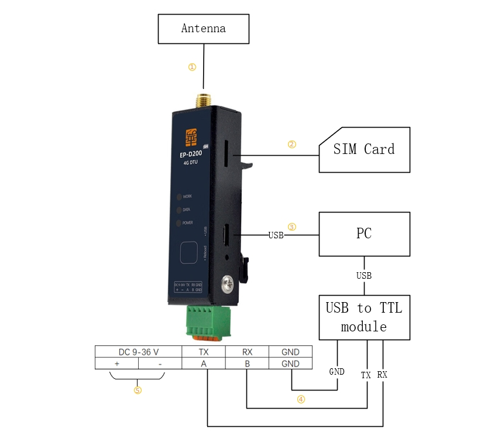
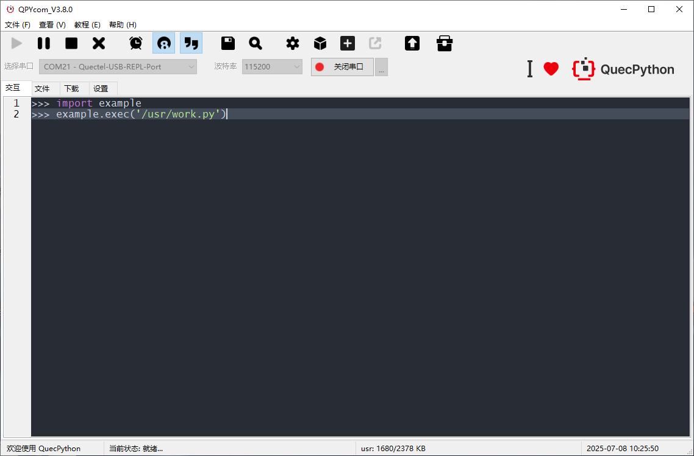

# Introduction to the EC800GCN Hua Series DTU Development Board
## Supported Module List 
- [EC800G-CN](https://www.quectel.com.cn/product/ec800g-cn)
## Feature List
### Basic Overview
The Hua series DTU products are equipped with Quectel EC800G-CN modules, supporting 4G Cat1 full network compatibility. They can achieve data transmission between serial ports and 4G (CAT1), offering wider coverage, faster speed, and lower latency compared to traditional 2G/3G networks. They are powered by wide voltage (9~36V). With a variety of interfaces available, including RS232, RS485, and TTL, they are easy to develop and support transparent transmission and Python secondary development. They are safe and reliable, featuring both software and hardware watchdogs. Compact in size and easy to install (22.6 * 74.6 mm). 

Product Features: 
- Small size
- Full network 4G Cat1
- 9~36V wide voltage supply
- Finished products can be installed by hanging or on a rail
- Software and hardware watchdog
- Optional RS232/RS485/TTL three interfaces
- Support Python secondary development

## Development board resources
### Function description
The main components and interface layout of the development board are shown in the following figure. 



① Connect the glue stick antenna. 

② Insert the Nano SIM card 

③ Connect to the computer using a mini USB data cable. 

④ Connect to the computer using a USB-to-TTL module. Connect TX (DTU development board) to RX (USB-to-TTL module); RX (DTU development board) to TX (USB-to-TTL module); and GND (DTU development board) to GND (USB-to-TTL module) for common ground. 

⑤ The development board adopts a wide voltage supply range of 9-36V, with positive and negative poles. 

|Interface	|Functions	|Descriptions|
|----|----|----|
|Serial Port *1	|Communication	|RS232 3P plug-in terminal (2.54mm)<br />RS485 2P plug-in terminal (2.54mm)<br />TTL 3P plug-in terminal (2.54mm)|
|USB|	Programming/Debugging|	microUSB cannot be used to power the device Used for firmware programming and Python script updates|
|LED|	POWER/WORK/DATA Indicator Lights|	POWER: Power indicator light, always on after power-on. <br />WORK: PinGPIO12, user-defined indicator light. <br />DATA: Pin.GPIO36, user-defined indicator light.|
|Reload	|Keypad Input|	Pin.GPIO29, user-defined purpose.|

>**Note**
> For more information, please visit https://www.quectel.com.cn/download-zone. 
## **Data Download**
[EP-D200 DTU Specification and User Guide](https://developer.quectel.com/en/wp-content/uploads/sites/2/2026/03/QuecPython_EP-D200_DTU_Specification_and_User_Guide_V1.0.0_Preliminary.pdf)

## Quick Start
### Hardware Preparation
The following are the hardware preparation steps after getting started with the development board. 
- <font color='red'>**Step 1: Hardware Preparation**</font>
  The following accessories need to be prepared before starting. 
  1. **Development board**
  2. **USB data cable (USB-A to USB-TypeC)**
  3. **PC (Windows10)**
  4. **Nano SIM card**
  5. **Adhesive stick antenna**
  6. **USB to TTL module**
- <font color='red'>**Step 2: Antenna & SIM card installation**</font>

Install the included adhesive rod antenna and insert the Nano SIM card into the SIM card slot on the development board. 

### Driver Installation
- [Open the QuecPython official website driver download link](https://www.quectel.com.cn/download-zone)
- Select the driver that matches the module model. The development board is equipped with the EC800G module. Taking the EC800G as an example, on the download page, select the USB driver for this model, [QuecPython_USB Driver Win10_U_G](https://developer.quectel.com/wp-content/uploads/2024/09/Quectel_Windows_USB_DriverU_V1.0.19.zip), on the right side and click to download. If the development board is equipped with other models, follow the same operation. 

- After downloading, extract the driver compressed package. Find either **setup.exe** or **setup.bat**, double-click to run it. Once the installation is complete, open the Device Manager and you will see that the yellow exclamation mark next to the port has disappeared, indicating that the installation was successful and normal communication is possible. 

> It is normal for devices such as <font color='red'>Mobile ECM Network Adapter</font> or <font color='red'>CDC Ethernet Control Model (ECM) </font>not to be recognized. This does not affect firmware burning or subsequent development, and can be ignored. 

- Right-click to open 【**My Computer**】 - select 【**Manage**】 - select 【**Device Manager**】, then in the Device Manager, choose 【**Ports**】. After following the steps to open the page, if the Quectel USB name starting serial port is refreshed as shown in the figure, the USB driver installation is successful.

### Tool Installation
- QPYcom Acquisition
To develop with QuecPython, a dedicated development and debugging tool - **QPYcom** is required, including but not limited to debugging code, analyzing logs, file transfer, firmware burning, and firmware merging. 
Open the [QuecPython tool download page](https://www.quectel.com.cn/download-zone) and select the corresponding tool to download based on your operating system. 

*Note: This tool does not require installation. Just extract and use.*
- VSCode extension

When editing Python code, people usually use an IDE specifically designed for Python or one that supports multiple languages, which can significantly enhance development efficiency. Here, I recommend VSCode. 

For VScode, QuecPython has launched a dedicated plugin to achieve functions such as code hinting, code completion, and serial port debugging. The installation method is shown in the following figure. 

In VSCode, click on the Extensions tab in the sidebar, search for "QuecPython" in the Extensions Marketplace, and download the plugin based on the search results. 


### Firmware burning
**Firmware acquisition**
Modules are usually burned with standard AT firmware or QuecOpen firmware at the factory. If you need to develop the module based on QuecPython, you need to manually re-burn a dedicated QuecPython firmware for it. 

[Official firmware download address](https://www.quectel.com.cn/download-zone)


When faced with a wide variety of firmware on the official website, to choose the appropriate firmware package, first, you need to know the model of the module you are using. The model of the module can be obtained through the laser engraving on the module or by sending AT commands. 

After obtaining the module model, you can download the corresponding firmware for the module from the official website based on its model. The name of the firmware is generally QPY_OCPU_version_number_module_model_FW. If there are no special requirements, it is recommended to download the latest version by default. 

Click the download button in the download column to start the download. After a successful download, you will obtain a compressed file (zip file) named after the firmware. 

The firmware package downloaded from the official website is in a compressed format. After downloading the firmware compressed package to your local device, you need to decompress it. After decompression, you can obtain two files. Among them, the one with the .bin format is the main body of the QuecPython firmware, and the one with the .md format is the update log. 

Please make sure to extract the contents of the compressed package to **a path that does not contain Chinese characters**, spaces, or other special characters. Otherwise, the download tool may not be able to correctly identify the firmware. At the same time, the path of the download tool should also **not contain Chinese characters, spaces, or other special characters**. 

**Firmware burning**

- <font color='red'>**Step 1: Create a Project**</font>

First, make sure the module is connected properly and powered on. Open the QPYcom tool and go to the download page. Click on "Create" to start a new project for the firmware you want to download. Name the project as you like. After configuring, save the settings persistently. 

- <font color='red'>**Step 2: Select Firmware**</font>

Select the firmware to be downloaded to the module (Choose the corresponding firmware based on the model of the module to be downloaded. If it is a new format firmware, select the .bin file for all module models.) 
If it is an old version of the firmware, the firmware file format may not end with ".bin". For the EC600U series modules, select the decompressed ".pac" file. 
- <font color='red'>**Step 3: Set the download mode**</font>

Click the **drop-down arrow to the right** of "Download script" and select "Download FW" 
- <font color='red'>**Step 4: Start Firmware Burning**</font>

Click on **"Download FW"** to start downloading the firmware. During the download process, a progress bar and percentage will be displayed. Once the download is complete, a pop-up window will prompt you that the download was successful. 


### REPL Debugging

REPL stands for **Read-Eval-Print-Loop (interactive interpreter)**, and QuecPython programs can be debugged in the REPL. 

After running the **QPYcom tool**, select the correct serial port (the baud rate does not need to be specified) and open it, and you can start the Python command-line interaction. 

- <font color='red'>**Step 1: Enter the interactive page**</font>

Open the QPYcom tool, select the **Quectel USB REPL Port** for connection, and choose the "Interactive" interface. 

- <font color='red'>**Step 2: Open the Serial Port**</font>

Click the "Open Serial Port" button. In the interactive interface, enter **print('hello world')**, and press Enter. You can then see the result information of the execution. 
```python
>>> print('hello world')
hello world
```


<font color='red'>*Note: When inputting on the tool interaction page, English characters need to be entered. Chinese characters will be blocked. *</font>

## Develop the first script
### Write the first script file

Create the *work.py* file to make the WORK indicator light periodically change between high and low levels every 0.2 seconds. The script is written as follows: 
```python
import utime
from machine import Pin
print('Start')
LED_Work = Pin(Pin.GPIO12, Pin.OUT, Pin.PULL_DISABLE, 1)
while True:
    if LED_Work.read():
    	LED_Work.write(0)
    else:
    	LED_Work.write(1)
    utime.sleep(0.2)
```
Download the above edited file to the module via QPYcom and run it. 


### File transfer between PC and mod
**Download method one:**


- <font color='red'>**Step 1: Open the Serial Port**</font>

First, select the communication port of the module, and then click the "Open Serial Port" button. 
- <font color='red'>**Step 2: Download via the tool buttons**</font>

Files can be uploaded and deleted through the "**+**" and "**-**" buttons on the right side of the file page. 
- <font color='red'>**Step 3: Download by Dragging**</font>

You can also drag the local files displayed on the left side of the file page directly into the module on the right side (folders can also be dragged). 
- <font color='red'>**Step 4: Download Progress and Results**</font>

During the download process, the file name being downloaded and the download progress will be displayed in the status bar. 

**Download Method Two:**


- <font color='red'>**Step 1: Create a Project**</font>

Based on the requirements, create a user project (click the "Create" button). The steps are the same as those described in the previous section for firmware burning. 
- <font color='red'>**Step 2: Configure the files to be downloaded**</font>

Select the user scripts to be downloaded to the module (add them in the "User Scripts" area via the right-click menu) 
- <font color='red'>**Step 3: Set the download mode**</font>

Left-click the **drop-down arrow and select** "Download Script". 
- <font color='red'>**Step 4: Start downloading the script**</font>

Click "Download Script" to start downloading the script. A progress bar will be displayed during the download process. 

### Run the script file

- <font color='red'>**Step 1: Download the script**</font>

Download the script file to be executed into the module. For specific steps, refer to the above text. 
- <font color='red'>**Step 2: Execute the script via REPL**</font>

After opening the serial port, enter the following code in the QPYcom interactive page to execute the script file. 

```python
import example
example.exec("/usr/work.py")  # filePath is the path of the script file to be executed
```
- <font color='red'>**Step 3: Execute the script through the GUI tool**</font>

Or execute the script file through the "**Execute**" button on the QPYcom file page. Select the script file to be executed on the file page of the tool and then click the "**▷**" button.
The execution result is shown in the figure. Observe the changes of the WORK indicator light. 



### Stop program execution
How to stop a running program depends on the type of script file being run. Here are the methods:

<table valign="center">
	<thead>
    <tr>
		<th>Is the program name<br>main.py?</th>
		<th>Does the program<br>contain an infinite loop?</th>
		<th>Does the program<br>use multithreading?</th>
		<th valign="middle">Stopping steps</th>
	</tr>
	 </thead>
    <tr>
		<td rowspan="4">✓</td>
		<td rowspan="2">✓</td>
		<td rowspan="1">✓</td>
		<td>(1) Press Ctrl + A to enter RAW mode<br>(2) Press Ctrl + D to restart the QuecPython virtual machine<br>(3) Press Ctrl + B to return to normal interactive mode<br>(4) If the above methods are ineffective, please reflash the firmware</td>
	</tr>
	<tr>
		<td rowspan="1">✗</td>
		<td>(1) Press Ctrl + C to interrupt the program<br>(2) If the above methods are ineffective, please reflash the firmware</td>
	</tr>
	<tr>
		<td rowspan="2">✗</td>
		<td rowspan="1">✓</td>
		<td>(1) Press Ctrl + A to enter RAW mode<br>(2) Press Ctrl + D to restart the QuecPython virtual machine<br>(3) Press Ctrl + B to return to normal interactive mode<br>(4) If the above methods are ineffective, please wait patiently for the program to finish</td>
	</tr>
	<tr>
		<td rowspan="1">✗</td>
		<td>(1) Press Ctrl + C to interrupt the program<br>(2) If the above methods are ineffective, please reflash the firmware</td>
	</tr>
	<tr>
		<td rowspan="4">✗</td>
		<td rowspan="2">✓</td>
		<td rowspan="1">✓</td>
		<td>(1) Press Ctrl + D to restart the QuecPython virtual machine<br>(2) If the above methods are ineffective, please restart the module directly</td>
	</tr>
	<tr>
		<td rowspan="1">✗</td>
		<td>(1) Press Ctrl + D to restart the QuecPython virtual machine<br>(2) If the above methods are ineffective, please restart the module directly</td>
	</tr>
	<tr>
		<td rowspan="2">✗</td>
		<td rowspan="1">✓</td>
		<td>(1) Press Ctrl + C to interrupt the program<br>(2) If the above methods are ineffective, please reflash the firmware or restart the module directly</td>
	</tr>
	<tr>
		<td rowspan="1">✗</td>
		<td>(1) Press Ctrl + C to interrupt the program<br>(2) If the above methods are ineffective, please reflash the firmware or restart the module directly</td>
	</tr>
</table>