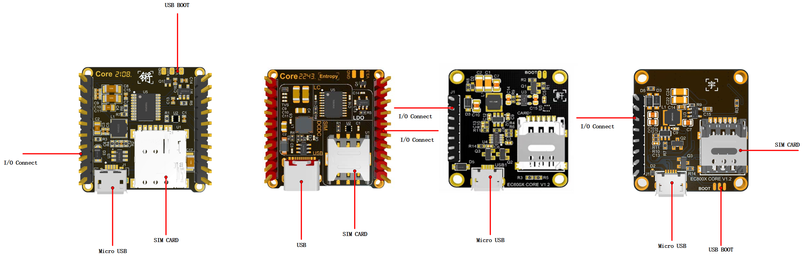
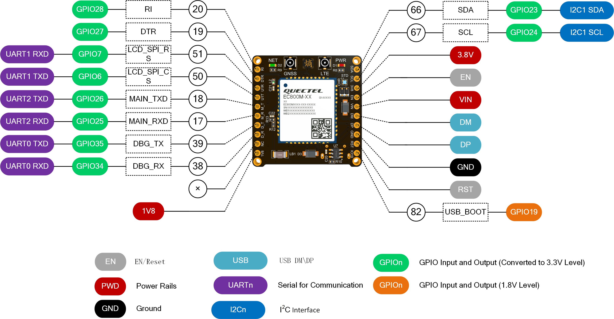
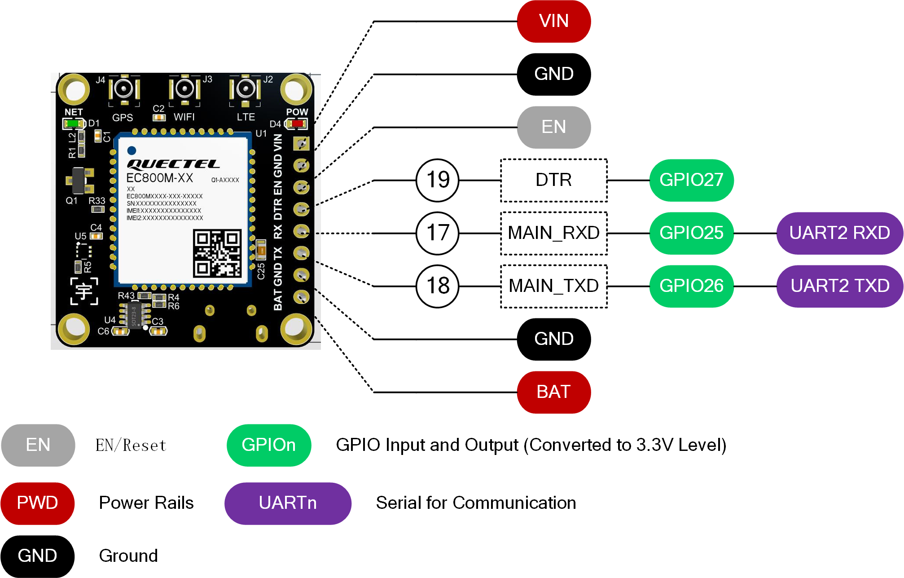

# EC800X Core EVB Introduction

## Quick Start

Supported Module List

- [EC800M-CNGB](https://developer.quectel.com/en/modules-cat/ec800m-series)
- [EC800M-CNGD](https://developer.quectel.com/en/modules-cat/ec800m-series)
- [EC800E-CNLE](https://developer.quectel.com/en/modules-cat/ec800m-series)
- [EC800M-CNLF](https://developer.quectel.com/en/modules-cat/ec800m-series)

## Feature List

### Overview

The QuecPython_EC800X core board is a core development board with the smallest functions specially made for QuecPython. Users can choose the corresponding model according to their needs, including single-row pin pure data transmission version, double-row pin pure data transmission version, single-row pin positioning data transmission version and double-row pin positioning data transmission version.

## Functional Description

The main functional components and interface layout of the development board are shown in the figure below.

## **Documents Download**

- [EC800X_Series_EVB_SCH](https://developer.quectel.com/en/wp-content/uploads/sites/2/2024/12/EC800X_Series_EVB_SCH.pdf)
- [EC800X_Series_EVB_SilkScreen](https://developer.quectel.com/en/wp-content/uploads/sites/2/2024/12/EC800X_Series_EVB_SilkScreen.pdf)

## EVB Resources

The main pin layout of the development board is shown in the following figure.

## Getting Started Preparation

**Step1: Antenna Installation**

Install the antenna that comes with the development board. The installation location is the LTE antenna seat, and insert the SIM card into the SIM card seat on the development board. If you need to use the GNSS function, you need to install the antenna in the corresponding antenna seat.

**Step2: Development board connection**

Use a USB Type-C data cable to connect the Type-C/Micro USB port of the development board and the USB port of the computer to complete the power supply and startup.

> If the POW light stays on, it means the power on is successful.