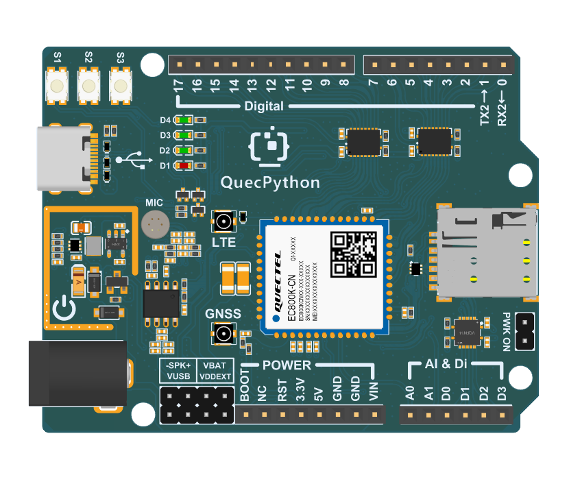
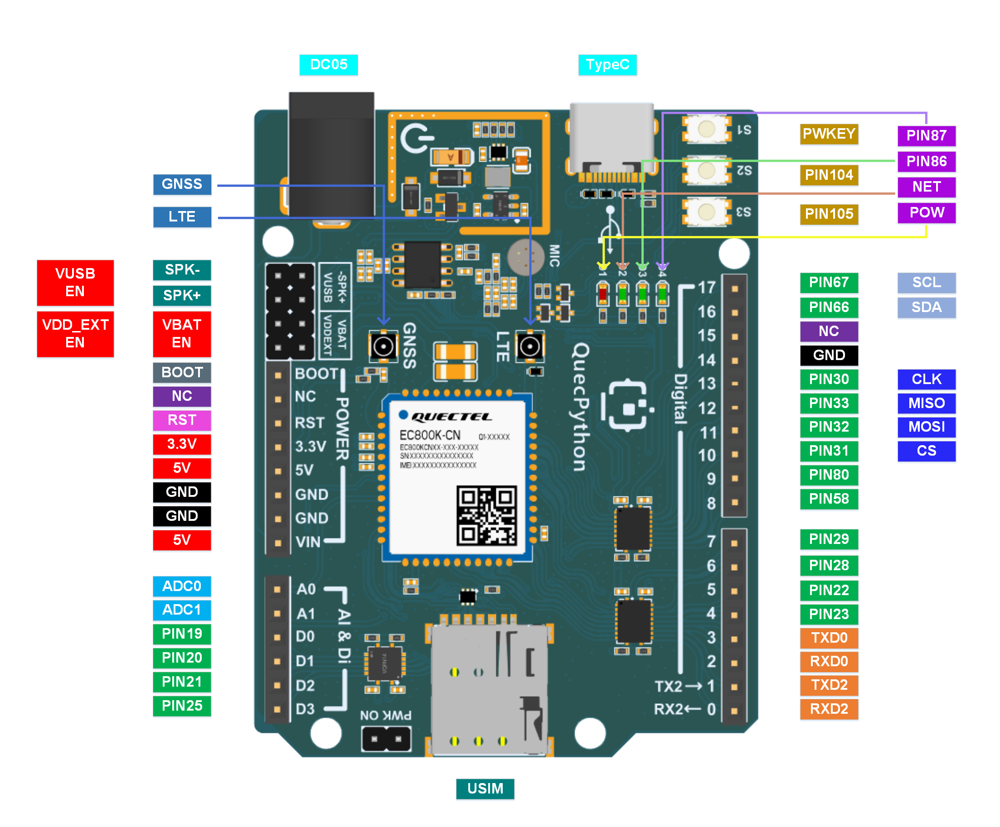

# EC800X QuecDuino EVB Introduction

## Supported Modules

### Supported module models
- EG800K
- [EC800M](https://www.quectel.com.cn/product/ec800m-cn)
- [EC800G](https://www.quectel.com.cn/product/ec800g-cn)
- EC800E

## Feature List

### Basic Overview

The EC800X QuecDuino EVB is equipped with Quectel EC800 series modules. It supports the following module series:  
EC800M series, EC800K series, EG800K series, EC800E series, etc.

### Rendering

The main components and interface layout of the development board are shown in the figure below.



### Document download

 [EC800X-QuecDuino-EVB](https://developer.quectel.com/en/wp-content/uploads/sites/2/2026/01/QuecPython_Ex800x_Series_QuecDuino_EVB_Specification_and_User_Guide_V1.0.0_Preliminary_20250605.pdf)

## EVB Resources

### EVB Interface

**Interface Definition / Pinout**

| Pin Header | Pin No. | Comment  | Feature                  |
| ---- | ---- | ---- | --------------------- |
| BOOT | -    | Module USB_BOOT Pin  |  Pull high or low (depending on the specific module model) to enter force download mode   |
| NC   | -    | floating  |  -    |
| RST  | -    | Module RESET Pin   |  Pull low to reset    |
| 3.3V | -    | Power Output  |  3.3V/200mA    |
| 5V   | -    | Power Input/Output  |  5V/2A(Leave floating/unconnected for V1.1 version)  |
| GND  | -    | Ground |  -  |
| GND  | -    | Ground |  -  |
| 5V   | -    | Power Input/Output  |  5V/2A(Leave floating/unconnected for V1.1 version)  |
| A0   | -    | Module ADC0 Input Pin  |  0-1.2V  |
| A1   | -    | Module ADC1 Input Pin  |  0-1.2V  |
| D0   | 19    | I/O  |  3.3V  |
| D1   | 20    | I/O  |  3.3V  |
| D2   | 21    | I/O  |  3.3V  |
| D3   | 25    | I/O  |  3.3V  |
| 0   | -    | Main UART Receive  |  3.3V  |
| 1   | -    | Main UART Transmit  |  3.3V  |
| 2   | -    | Auxiliary UART Receive  |  3.3V  |
| 3   | -    | Auxiliary UART Receive  |  3.3V  |
| 4   | 23    | I/O  |  3.3V  |
| 5   | 22    | I/O  |  3.3V  |
| 6   | 28    | I/O  |  3.3V  |
| 7   | 29    | I/O  |  3.3V  |
| 8   | 58    | I/O  |  3.3V  |
| 9   | 80    | I/O  |  3.3V  |
| 10  | 31    | I/O  |  3.3V  |
| 11  | 32    | I/O  |  3.3V  |
| 12  | 33    | I/O  |  3.3V  |
| 13  | 30    | I/O  |  3.3V  |
| 14  | -    |Ground   |  -  |
| 15  | -    |NC   |  Leave floating  |
| 16  | 66    | I/O  |  3.3V  |
| 17  | 67    | I/O  |  3.3V  |


The main pin layout of the development board is shown in the figure below.



> **Tips**
> For more information about the EVB, please visit <https://www.quectel.com.cn/download-zone>

### EVB Configuration

The EVB is equipped with various sensors and other peripherals. The pins of peripherals are shown in the table below.

| No. | Name                         | Model          | Supports  | Interface Type | Pin No.  |
| ---- | ----------------------------| -------------  | --------  | -------- | ----- |
| 1    | USB Interface               | -              | yes       | Type-C   | -     |
| 2    | LED Indicator               | -              | yes       | GPIO     | -     |
| 3    | Microphone                  | B4013AM423-092 | yes       | SPK      | -     |


- ## Quick Start Guide

  ### Hardware Preparation

  - <font color='red'>**Step 1: Required Items**</font>

    - Development board
    - USB-C cable (A-to-C)
    - Windows 10 PC
    - Nano-SIM card
    - 4G antenna

  - <font color='red'>**Step 2: Antenna & SIM Installation**</font>

    - Attach the provided antenna to the MAIN antenna port.
    - Insert the SIM card into the Nano-SIM slot.

  - <font color='red'>**Step 3: Connect the Board**</font>

    - Connect the development board's Type-C port to a computer USB port using a USB Type-C cable to supply power. Before powering on, ensure to short the VUBS EN, VDD_EXT EN, and VBAT EN jumper pins.

  - <font color='red'>**Step 4: Power On**</font>

    - Press and hold S1 until the power indicator light (labeled D1 on the board) on the main board illuminates. If PWK_ON has been shorted in the previous step, there is no need to press and hold the power key, as the system will boot automatically. 


    > <font color='red'>**For detailed information regarding the development board's indicator lights and power settings, please refer to the specifications document.**</font>

  ### Driver Installation

  1. Download the **QuecPython USB Driver** from [QuecPython Official Drivers](https://www.quectel.com.cn/download-zone).
  2. Extract and run `setup.exe` or `setup.bat`.
  3. Verify installation in **Device Manager** (look for "Quectel USB" ports). Ignore unrelated devices like "Mobile ECM Network Adapter."

  ### Tool Installation

  1. **QPYcom**: Download from [QuecPython Tools](https://www.quectel.com.cn/download-zone). Extract and use directly.
  2. **VSCode Plugin**: Search for "QuecPython" in the Visual Studio Code marketplace.

  ### Firmware Burning

  1. **Firmware Download**: Get the latest QuecPython firmware  from [QuecPython Firmware](https://www.quectel.com.cn/download-zone) Page.

  2. **Burning Steps**:
     - Open QPYcom, select the USB REPL port, and create a new project.
     - Choose the `.bin` firmware file 
     - Set mode to "Download FW" and click **Download**.
     - For BG95, enable DM serial port before burning.

  

  

  

  ### REPL Debugging

  1. Connect via QPYcom and open the REPL interface.
  2. Test with `print("Hello World!")`.

  

  ## First Script Development

  ### Writing a Script

  Create `helloworld.py`:

  ```python
  print("Hello World!")
  ```

  ### File Transfer

  - **Method 1**: Drag-and-drop files via QPYcom’s GUI.

  

  - **Method 2**: Use the "Download Script" feature in QPYcom.

  

  ### Running Scripts

  Execute via REPL:

  ```python
  import example
  example.exec("/usr/helloworld.py")
  ```

  ### Stopping Program Execution

  How to stop a running program. The following methods are provided according to the type of the running script file: 

<table valign="center">
	<thead>
    <tr>
		<th>Is the program name<br/>main.py?</th>
		<th>Does the program contain<br/>a dead loop?</th>
		<th>Does the program<br/>use multiple threads?</th>
		<th valign="middle">Stopping Steps</th>
	</tr>
	 </thead>
    <tr>
		<td rowspan="4">✓</td>
		<td rowspan="2">✓</td>
		<td rowspan="1">✓</td>
		<td>(1) Press Ctrl + A to enter RAW mode<br/>(2) Press Ctrl + D to restart the QuecPython VM<br/>(3) Press Ctrl + B to return to normal interactive mode<br/>(4) If the above fails, re-burn the firmware</td>
	</tr>
	<tr>
		<td rowspan="1">✗</td>
		<td>(1) Press Ctrl + C to interrupt program execution<br/>(2) If the above fails, re-burn the firmware</td>
	</tr>
	<tr>
		<td rowspan="2">✗</td>
		<td rowspan="1">✓</td>
		<td>(1) Press Ctrl + A to enter RAW mode<br/>(2) Press Ctrl + D to restart the QuecPython VM<br/>(3) Press Ctrl + B to return to normal interactive mode<br/>(4) If the above fails, wait for the program to finish running</td>
	</tr>
	<tr>
		<td rowspan="1">✗</td>
		<td>(1) Press Ctrl + C to interrupt program execution<br/>(2) If the above fails, re-burn the firmware</td>
	</tr>
	<tr>
		<td rowspan="4">✗</td>
		<td rowspan="2">✓</td>
		<td rowspan="1">✓</td>
		<td>(1) Press Ctrl + D to restart the QuecPython VM<br/>(2) If the above fails, directly restart the module</td>
	</tr>
	<tr>
		<td rowspan="1">✗</td>
		<td>(1) Press Ctrl + D to restart the QuecPython VM<br/>(2) If the above fails, directly restart the module</td>
	</tr>
	<tr>
		<td rowspan="2">✗</td>
		<td rowspan="1">✓</td>
		<td>(1) Press Ctrl + C to interrupt program execution<br/>(2) If the above fails, re-burn the firmware or directly restart the module</td>
	</tr>
	<tr>
		<td rowspan="1">✗</td>
		<td>(1) Press Ctrl + C to interrupt program execution<br/>(2) If the above fails, re-burn the firmware or directly restart the module</td>
	</tr>
</table>
