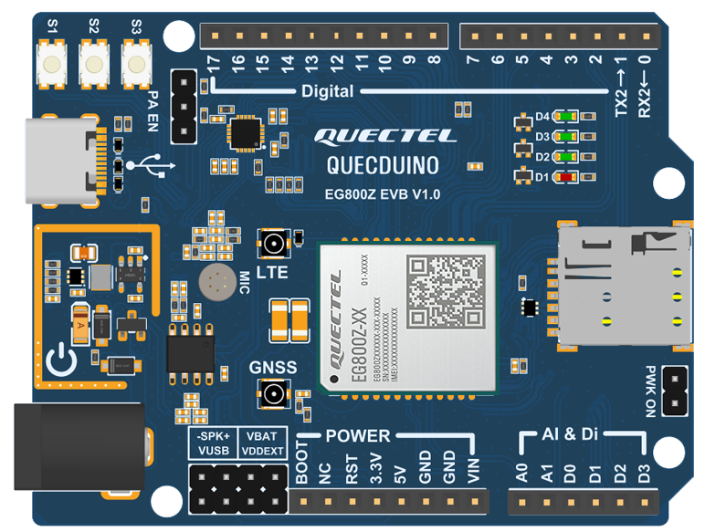
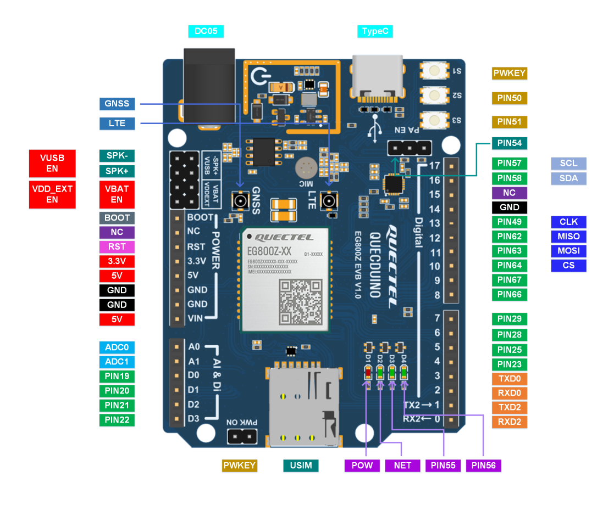
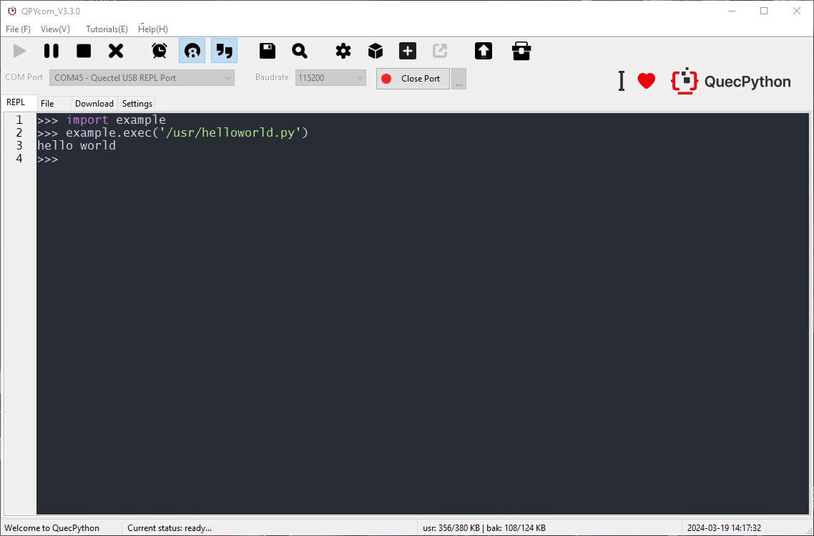

# EG800Z QuecDuino EVB Introduction

<!--
TODO（To be completed after datasheet / images are provided）:
  1. Module variant: EG800Z specific variant (e.g. EG800Z-CN) — confirm against datasheet
  2. Board images: Replace with EG800Z teal/cyan board images (place in ./media/eg800z-duino-evb/)
  3. Datasheet download link (provided by 吕总)
  4. Pin definition table: Fill according to datasheet; must reflect new external codec pins; NOT compatible with previous EC800X board — do NOT copy from old table
  5. Peripheral/sensor configuration table: Fill according to datasheet; must add a row for "external codec" (model/interface/pins)
  6. Codec details: Model, occupied pins, external audio capabilities (input/output channels) — pending confirmation from 坤明 / 李雪康
  7. Quick Start hardware details: Jumper caps (VUBS EN / VDD_EXT EN / VBAT EN), buttons (S1), silkscreen (D1), etc. — verify against EG800Z datasheet

Note: "Driver Installation / Tool Installation / Firmware Burning / REPL Debugging / First Script Development" are generic QuecPython onboarding steps, reused from the EC800X QuecDuino page.
-->

## Supported Modules

<!-- TODO: Specific module variant (EG800Z / EG800Z-CN, etc.) — confirm against datasheet -->
- [EG800Z](https://developer.quectel.com/en/modules-cat/eg800z-series)

## Features

### Overview

The EG800Z QuecDuino EVB is equipped with the Quectel EG800Z LTE wireless communication module. It is the upgraded revision of the EC800X QuecDuino development board, designed specifically for QuecDuino entry-level sensor experiment scenarios.

> **Key Changes (not compatible with previous generation)**: An **external codec** (audio codec) has been added. Audio-related functionality is incompatible with the previous generation board.
<!-- TODO: Codec model, occupied pins, external audio capabilities (input/output channels) — pending confirmation from 坤明 / 李雪康 -->

### Board Layout

The main components and interface layout of the development board are shown below:

<!-- TODO: Replace with EG800Z QuecDuino images (teal/cyan board), place images in ./media/eg800z-duino-evb/ -->


## Downloads

<!-- TODO: Replace with EG800Z QuecDuino datasheet download link (provided by 吕总) -->
- [EG800Z-QuecDuino-EVB-Datasheet](https://developer.quectel.com/en/wp-content/uploads/sites/2/2026/08/Quectel_EG800Z_Series_QuecDuino_EVB_Specification_V1.0.pdf)

## EVB Resources

### EVB Interface

**Pin Definitions**

<!-- TODO: Fill pin definitions according to EG800Z datasheet; note new codec-related pins; NOT compatible with previous generation — do NOT copy from old table -->
| Pin Header | Pin | Description | Function |
| ---- | ---- | ---- | --------------------- |
| | | | |

The main pin layout of the development board is shown below:

<!-- TODO: Replace with EG800Z QuecDuino pin diagram (teal/cyan board), place images in ./media/eg800z-duino-evb/ -->


> **Tip**
> For more information about the EVB, please visit <https://www.quectel.com.cn/download-zone>

### EVB Configuration

The EVB is equipped with various sensors and other peripherals. The pin assignments of peripherals are shown in the table below:

<!-- TODO: Fill peripheral/sensor configuration according to datasheet; must add a row for "external codec"; verify whether old board features like microphone are still present -->
| No. | Name | Model | Supported | Interface Type | Pin |
| ---- | ---------------------------- | ------------- | -------- | -------- | ----- |
| | | | | | |

## Quick Start Guide

### Hardware Preparation

<!-- TODO: The following hardware details (jumper caps, button silkscreen labels) — verify against EG800Z datasheet -->
Follow the steps below to prepare the hardware before getting started:

- <font color='red'>**Step 1: Required Items**</font>
  Items required before getting started:
  1. **Development Board**
  2. **USB Cable** (USB-A to USB Type-C)
  3. **PC** (Windows 10)
  4. **SIM Card**
  5. **4G Antenna**

- <font color='red'>**Step 2: Antenna & SIM Installation**</font>
  Attach the provided antenna to the LTE antenna port and insert the SIM card into the SIM card slot on the board.

- <font color='red'>**Step 3: Connect the Board**</font>
  Use a USB Type-C cable to connect the board's Type-C port to a USB port on your computer for power supply. Before powering on, ensure the VUBS EN, VDD_EXT EN, and VBAT EN jumper pins are shorted with jumper caps.

- <font color='red'>**Step 4: Power On**</font>
  Press and hold S1 until the power indicator light on the main board illuminates (the LED labeled D1 on the board). If PWK_ON has been shorted in the previous step, there is no need to long-press PWRKEY — the board will power on automatically.

`For detailed information regarding the board's indicator lights and power settings, please refer to the datasheet.`

### Driver Installation

- Go to the [QuecPython Official Driver Download](https://www.quectel.com.cn/download-zone) page.

- Select the driver that matches your module model. This EVB is equipped with the EG800Z module. Taking EG800Z as an example, select the corresponding USB driver [QuecPython_USB Driver Win10_U_G](https://developer.quectel.com/wp-content/uploads/2024/09/Quectel_Windows_USB_DriverU_V1.0.19.zip) on the right side of the download page and click download. If your EVB is equipped with a different module model, follow the same steps accordingly.

- After downloading, extract the driver archive, locate **"setup.exe"** or **"setup.bat"**, and double-click to run. Once installation is complete, open Device Manager — the yellow exclamation mark on the port in Device Manager will disappear, indicating successful installation and normal communication.

> Devices such as <font color='red'>Mobile ECM Network Adapter</font> or <font color='red'>CDC Ethernet Control Model (ECM)</font> appearing as unrecognized are normal phenomena and do not affect firmware burning or subsequent development. No action is required.

- Right-click on **My Computer** → select **Manage** → select **Device Manager**, then in Device Manager select **Ports**. After following these steps, if a serial port starting with **Quectel USB** appears as shown, the USB driver has been installed successfully.

### Tool Installation

- **QPYcom**

  QuecPython development requires a dedicated debugging tool — **QPYcom**, which supports code debugging, log analysis, file transfer, firmware burning, and firmware merging, among other functions.

  Go to the [QuecPython Tools Download](https://www.quectel.com.cn/download-zone) page and select the appropriate tool for your operating system.

  *Note: This tool does not require installation — simply extract and use.*

- **VSCode Plugin**

  For editing Python code, an IDE dedicated to Python or compatible with multiple languages is generally recommended to effectively improve development efficiency. VSCode is recommended here.

  QuecPython provides a dedicated VSCode plugin that enables code hints, code completion, and serial debugging. Installation steps are shown below:

  Click the Extensions sidebar in VSCode, search for "QuecPython" in the marketplace, and download the plugin from the search results.

  

### Firmware Burning

**Firmware Download**

Modules are typically shipped with standard AT firmware or QuecOpen firmware. If you need to develop based on QuecPython, you must manually re-burn dedicated QuecPython firmware onto the module.

[Official Firmware Download](https://www.quectel.com.cn/download-zone)


With the wide variety of firmware available on the official website, how do you choose the right firmware package? First, you need to know the model of the module you are using. The module model can be obtained from the module's laser engraving or by sending AT commands.

Once you have the module model, go to the official website and download the corresponding firmware for that model. The firmware file name generally follows the pattern `QPY_OCPU_<version>_<module_model>_FW`. Unless you have special requirements, it is recommended to download the latest version by default.

Click the download button in the download column to download. After a successful download, you will get a compressed package file (zip) named after the firmware.

The firmware package downloaded from the official website is in compressed format. After downloading to your local machine, you need to extract it. After extraction, you will obtain two files: the `.bin` file is the QuecPython firmware itself, and the `.md` file is the changelog.

> Please make sure to extract the contents of the compressed package to a path that does **not contain Chinese characters, spaces, or other special characters**, otherwise the download tool may not be able to recognize the firmware properly. Similarly, the download tool path must **not contain Chinese characters, spaces, or special characters**.

**Burning Steps**

- <font color='red'>**Step 1: Create a Project**</font>

  First, ensure the module is properly connected and powered on. Open the QPYcom tool and go to the download page. Click **"Create"** to create a new firmware project. The project name can be customized, and the configuration will persist after completion.

- <font color='red'>**Step 2: Select Firmware**</font>

  Select the firmware to be downloaded to the module (choose the corresponding firmware based on the module model to be downloaded. For new-format firmware, simply select the `.bin` file for all module models).

- <font color='red'>**Step 3: Set Download Mode**</font>

  Click the dropdown arrow to the right of **"Download script"** and select **"Download FW"**.

- <font color='red'>**Step 4: Start Burning Firmware**</font>

  After clicking **"Download FW"**, firmware burning will begin. The download process will show a progress bar and percentage. Wait for the download to complete — a popup dialog will confirm successful download.

  

### REPL Debugging

REPL stands for <font color='red'>**Read-Eval-Print-Loop (Interactive Interpreter)**</font>. You can debug QuecPython programs in the REPL.

After running the **QPYcom** tool, select the correct serial port (baud rate does not need to be specified) and open it to start Python command-line interaction.

- <font color='red'>**Step 1: Enter the Interactive Page**</font>

  Open the QPYcom tool, select the port connected to **Quectel USB REPL Port**, and switch to the "Interactive" tab.

- <font color='red'>**Step 2: Open the Serial Port**</font>

  Click the "Open Serial Port" button, then enter **print('hello world')** in the interactive interface and press Enter to see the execution result.

  ```python
  >>> print('hello world')
  hello world
  ```

  

<font color='red'>*Note: When using the interactive interface, ensure you type in English characters — Chinese characters will be filtered.*</font>

## First Script Development

### Writing Your First Script

Create a *helloworld.py* file to output "hello world". Write the script as follows:

```python
print("hello world")
```

Download the edited file to the module using QPYcom and run it.

### File Transfer Between PC and Module

**Download Method 1:**


- <font color='red'>**Step 1: Open the Serial Port**</font>

  First select the module's interactive port and click the "Open Serial Port" button.

- <font color='red'>**Step 2: Download via Tool Buttons**</font>

  Use the "**+**" and "**-**" buttons on the right side of the file page to upload and delete files.

- <font color='red'>**Step 3: Download via Drag and Drop**</font>

  You can also drag and drop local files displayed on the left side of the file page directly onto the module on the right side (folders can also be dragged).

- <font color='red'>**Step 4: Download Progress and Results**</font>

  During the download process, the file name and download progress will be displayed in the status bar.

**Download Method 2:**


- <font color='red'>**Step 1: Create a Project**</font>

  Create a user project as needed (click the "Create" button). The steps are the same as for firmware burning above.

- <font color='red'>**Step 2: Configure Files to Download**</font>

  Select the user scripts to be downloaded to the module (add them via the right-click menu in the "User Scripts" area).

- <font color='red'>**Step 3: Set Download Mode**</font>

  Click the dropdown arrow and select "Download Script".

- <font color='red'>**Step 4: Start Downloading Scripts**</font>

  Click "Download Script" to start downloading scripts. The download process will show a progress bar.

### Running Script Files

- <font color='red'>**Step 1: Download Scripts**</font>

  Download the script files to be executed to the module. Refer to the steps above for details.

- <font color='red'>**Step 2: Execute Scripts via REPL**</font>

  After opening the serial port, enter the following code in the QPYcom interactive page to execute the script file:

  ```python
  import example
  example.exec("/usr/helloworld.py") # filePath is the path of the script file to be executed
  ```

- <font color='red'>**Step 3: Execute Scripts via GUI Tool**</font>

  Alternatively, execute script files using the **Run** button on the QPYcom file page. On the tool's file page, select the script file to be executed and click the "**▶**" button.

  The execution result is shown below:

  

### Stopping Program Execution

How to stop a running program. The following methods are provided according to the type of the running script file:

<table valign="center">
	<thead>
    <tr>
		<th>Is the program name<br/>main.py?</th>
		<th>Does the program contain<br/>a dead loop?</th>
		<th>Does the program<br/>use multiple threads?</th>
		<th valign="middle">Stopping Steps</th>
	</tr>
	 </thead>
    <tr>
		<td rowspan="4">✓</td>
		<td rowspan="2">✓</td>
		<td rowspan="1">✓</td>
		<td>(1) Press Ctrl + A to enter RAW mode<br/>(2) Press Ctrl + D to restart the QuecPython VM<br/>(3) Press Ctrl + B to return to normal interactive mode<br/>(4) If the above fails, re-burn the firmware</td>
	</tr>
	<tr>
		<td rowspan="1">✗</td>
		<td>(1) Press Ctrl + C to interrupt program execution<br/>(2) If the above fails, re-burn the firmware</td>
	</tr>
	<tr>
		<td rowspan="2">✗</td>
		<td rowspan="1">✓</td>
		<td>(1) Press Ctrl + A to enter RAW mode<br/>(2) Press Ctrl + D to restart the QuecPython VM<br/>(3) Press Ctrl + B to return to normal interactive mode<br/>(4) If the above fails, wait for the program to finish running</td>
	</tr>
	<tr>
		<td rowspan="1">✗</td>
		<td>(1) Press Ctrl + C to interrupt program execution<br/>(2) If the above fails, re-burn the firmware</td>
	</tr>
	<tr>
		<td rowspan="4">✗</td>
		<td rowspan="2">✓</td>
		<td rowspan="1">✓</td>
		<td>(1) Press Ctrl + D to restart the QuecPython VM<br/>(2) If the above fails, directly restart the module</td>
	</tr>
	<tr>
		<td rowspan="1">✗</td>
		<td>(1) Press Ctrl + D to restart the QuecPython VM<br/>(2) If the above fails, directly restart the module</td>
	</tr>
	<tr>
		<td rowspan="2">✗</td>
		<td rowspan="1">✓</td>
		<td>(1) Press Ctrl + C to interrupt program execution<br/>(2) If the above fails, re-burn the firmware or directly restart the module</td>
	</tr>
	<tr>
		<td rowspan="1">✗</td>
		<td>(1) Press Ctrl + C to interrupt program execution<br/>(2) If the above fails, re-burn the firmware or directly restart the module</td>
	</tr>
</table>
