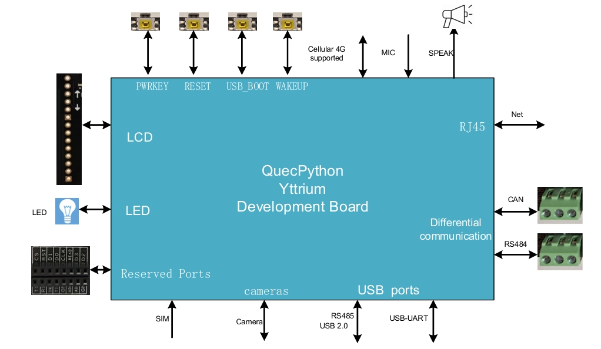
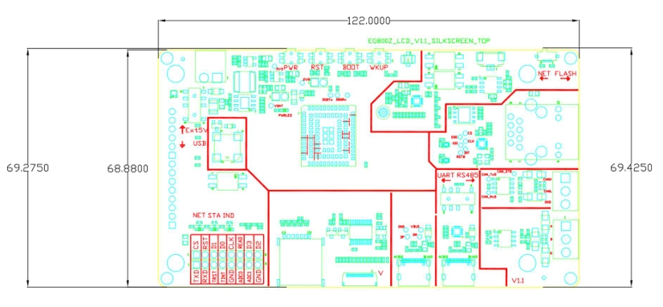
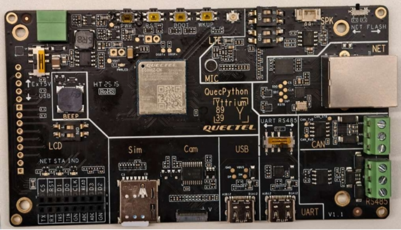
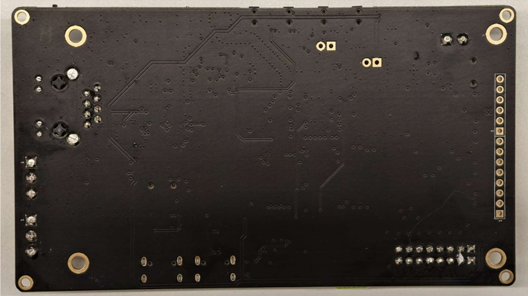
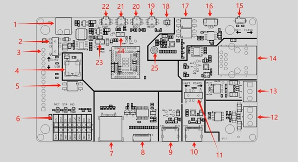

# QuecPython Yttrium Evaluation Board Introduction

## Supported Modules

- [EG800Z-CN](https://www.quectel.com.cn/product/lte-standard-eg800z-series)

## Features

### Overview

The QuecPython Yttrium evaluation board is a Python-ecosystem development board designed specifically for development, debugging, and solution demonstration scenarios. The main module is equipped with the EG800Z LTE wireless communication module.

The board features dual USB Type-C interfaces for convenient power supply and serial debugging. It also supports an external power terminal supply solution, allowing flexible adaptation to different development scenarios.

It integrates a rich set of interfaces including LCD display, camera capture, audio input/output, cellular network, 100 Mbps Ethernet, industrial-grade CAN/RS485 buses, and more. This makes it well-suited for IoT development, industrial communication, multimedia interaction, and various other application scenarios.

### Hardware Description

The main components and interface layout of the evaluation board are shown below:



Evaluation board dimensions (top view):



Top view and bottom view of the evaluation board:





## Downloads

- [EG800Z-Yttrium Datasheet](https://developer.quectel.com/wp-content/uploads/2026/04/Quectel_QuecPython_Yttrium%E5%BC%80%E5%8F%91%E6%9D%BF_%E4%BA%A7%E5%93%81%E8%A7%84%E6%A0%BC%E4%B9%A6_V1.0.1_Preliminary_20260401-.pdf)

## Board Resources

### Basic Specifications

| Item                | Specification                                                |
| ------------------- | ------------------------------------------------------------ |
| Package             | PCBA                                                         |
| Dimensions (mm)     | (122.0 ± 0.2) × (68.9 ± 0.2) × (1.6 ± 0.1)                  |
| Weight (g)          | 49.2 ± 0.2                                                   |
| Operating Temp.     | -10 ~ +50 °C                                                 |
| Storage Temp.       | -20 ~ +60 °C                                                 |
| Power Supply        | USB Type-C 5V ± 5% / 3.81mm terminal block 5V ± 5%          |
| Firmware Upgrade    | USB / OTA                                                    |

### Board Interfaces



The detailed assignment of the board interfaces is as follows:

| No.                | Interface             | Description                                                  |
| ------------------ | --------------------- | ------------------------------------------------------------ |
| **Reserved Ports** |                       |                                                              |
| 6 (J0702)          | 1 × 8-Pin Header      | MAIN_TXD, MAIN_RXD, LCD, CTP_INT, GND, ADC signals           |
| 6 (J0703)          | 1 × 8-Pin Header      | QSPI_D3, QSPI_D2, LCD signals                                |
| **Buttons & Switches** |                   |                                                              |
| 2                  | S0301                 | Determines the board power source: toggle up for external DC 5V; toggle down for USB Type-C 5V |
| 5                  | S0705                 | DIP switch for LED_PWM4 / GPIO2 multiplexing. S0705 pins 2-4 ON + S0502 pins 1-3 OFF: LED_PWM4 controls IND_LED. S0705 pins 2-4 OFF + S0502 pins 1-3 ON: LED_PWM4 provides PWM4 audio output. S0705 pins 1-3 ON: GPIO2 controls buzzer BEEP |
| 11                 | S0401                 | Determines main UART routing: toggle left for USB Type-C UART; toggle right for RS485 |
| 15                 | S0601                 | DIP switch for SPI0 routing to NET or FLASH                  |
| 17                 | S0501 / S0502         | S0501 ON + S0502 OFF: module PCM pins route through Codec to amplifier and speaker. S0501 OFF + S0502 ON: module PWM4 pin routes through filter circuit to amplifier and speaker |
| 19                 | WAKEUP                | Press to wake up the module                                  |
| 20                 | USB_BOOT              | Press before power-on to enter forced download mode          |
| 21                 | RESET                 | Press to restart the module                                  |
| 22                 | PWRKEY                | Press to power on the module                                 |
| **Communication**  |                       |                                                              |
| 12                 | RS485                 | RS485 connector: RS485_A, RS485_B, GND; half-duplex          |
| 13                 | CAN                   | CAN connector: CAN_H, CAN_L, GND; 1 Mbps data rate           |
| 14                 | Ethernet              | 1 × RJ45 connector, supports 10/100 Mbps Ethernet; Link LED and Activity LED indicators |
| **Camera**         |                       |                                                              |
| 8 (J0501)          | 1 × 18-Pin FPC        | Camera signal connector, supports 0.3 MP, SPI interface      |
| **Buzzer**         |                       |                                                              |
| 4                  | BEEP                  | Buzzer; S0705 pins 1-3 ON: GPIO2 controls buzzer BEEP        |
| **LCD Display**    |                       |                                                              |
| 3                  | 1 × 14-Pin Header     | LCD resolution 320×480; 4.0-inch screen; capacitive touch panel; display interface: 4-Line SPI, driver ICST7796S; touch interface: I2C, driver FT6336U |
| **Audio**          |                       |                                                              |
| 16                 | SPEAK                 | Audio output, external speaker support                       |
| 25                 | MIC                   | Onboard microphone SOM4013SL-G423L                           |
| **USB Ports**      |                       |                                                              |
| 9                  | USB Type-C            | 1 × USB 2.0 Type-C, up to 480 Mbps data rate; can serve as power input |
| 10                 | USB Type-C to UART    | 1 × USB 2.0 Type-C, up to 12 Mbps data rate; converted to TTL via XR21B1411IL16 chip, connected to module main UART |
| **LTE Module**     |                       |                                                              |
| 7                  | SIM Card Slot         | MUP-C7081-2, Nano SIM, 1.8V / 3.0V                           |
| 18                 | Antenna Connector     | Supports external LTE antenna                                |
| **Power & Startup**|                       |                                                              |
| 1                  | External DC Input     | 3.81mm terminal block, 5V ± 5%                               |
| 23 (J0203)         | VBAT & VBAT12 Test Point | Remove resistor R0204 above this test point; connect an ammeter in series to measure module current |
| 24                 | PWRKEY & GND Test Point | Short before power-on for auto-startup                      |

#### Reserved Port Pin Assignments

##### J0702 8-Pin Header Pin Assignments

| Header      | Pin | Signal   | Function                    |
| :---------: | :-: | :------: | :-------------------------: |
| J0702 8-Pin |  1  | MAIN_TXD | Main UART transmit          |
| J0702 8-Pin |  2  | MAIN_RXD | Main UART receive           |
| J0702 8-Pin |  3  | LCD_SIG  | LCD related signal          |
| J0702 8-Pin |  4  | CTP_INT  | Capacitive touch interrupt  |
| J0702 8-Pin |  5  | GND      | Ground                      |
| J0702 8-Pin |  6  | ADC0     | ADC input signal            |
| J0702 8-Pin |  7  | ADC1     | ADC input signal            |
| J0702 8-Pin |  8  | GND      | Ground                      |

##### J0703 8-Pin Header Pin Assignments

| Header      | Pin | Signal   | Function                      |
| :---------: | :-: | :------: | :---------------------------: |
| J0703 8-Pin |  1  | CS       | SPI chip select               |
| J0703 8-Pin |  2  | RST      | SPI reset                     |
| J0703 8-Pin |  3  | QSPI_D1  | QSPI bus data 1               |
| J0703 8-Pin |  4  | QSPI_D0  | QSPI bus data 0               |
| J0703 8-Pin |  5  | CLK      | LCD clock signal              |
| J0703 8-Pin |  6  | READ     | Ground                        |
| J0703 8-Pin |  7  | QSPI_D3  | QSPI bus data 3               |
| J0703 8-Pin |  8  | QSPI_D2  | QSPI bus data 2               |

### Key Features

| Category                     | Description                                                  |
| ---------------------------- | ------------------------------------------------------------ |
| USB Interface                | 1 × USB 2.0 interface, up to 480 Mbps; 1 × USB Type-C connector, can serve as power input |
| UART                         | 1 × USB 2.0 interface, up to 12 Mbps; 1 × USB Type-C connector, can serve as power input; converted to UART via XR21B1411 chip, connected to module main UART |
| RS485                        | Main UART converted to RS485 via a DPDT switch and RS485 transceiver (SIT3088E) |
| LCD Interface                | LCD resolution 320×480; 4.0-inch screen; capacitive touch panel; display interface: 4-Line SPI, driver ICST7796S; touch interface: I2C, driver FT6336U |
| Audio — Speaker              | 1 × CS8126, 2W Class-D audio amplifier, supports audio output |
| Audio — MIC                  | 1 × SOM4013SL-G423L onboard microphone, supports audio input |
| Audio — Codec                | 1 × ES8311 Codec chip, connected to module via PCM and I2C for audio functionality |
| Compatible Audio Output      | 1 × PWM signal and filter circuit designed for validating PWM audio output |
| Camera                       | 1 × 16-pin FPC connector; camera interface: SPI, driver GC032A; resolution: 0.3 MP |
| CAN                          | Integrated CAN controller via CAN transceiver SIT65HVD230, compliant with ISO 11898; supports up to 120 nodes on a single bus; max data rate 1 Mbps |
| Ethernet                     | 1 × RJ45 connector, supports 10/100 Mbps Ethernet; Link LED and Activity LED indicators |
| SIM Card                     | 1 × MUP-C7081-2 slot, supports Nano SIM; 1.8V and 3V dual voltage |
| Reserved Headers             | 2 × 8-Pin headers; ADC, main UART, QSPI signals brought out  |
| Buttons                      | 1 × PWRKEY power-on button; 1 × RESET reset button; 1 × BOOT forced download button; 1 × WAKEUP wake-up button |
| LED Indicators               | PWRLED (red): module power indicator; INDLED (green): module operation indicator, user-programmable |
| Buzzer                       | 1 × Beep buzzer                                              |
| Firmware Upgrade             | USB / OTA                                                    |

#### Onboard Buttons and Indicators

The board features 4 functional buttons and 2 status LEDs:

- **PWRKEY**: Power-on button. Long press to power on the module.
- **RESET**: Reset button. Press to trigger a module restart.
- **BOOT**: Forced download button. Press and hold before power-on to enter forced firmware download mode.
- **WAKEUP**: Wake-up button. Press to wake the module from sleep.
- **PWRLED**: Red power indicator. Stays lit when the module is properly powered.
- **INDLED**: Green operation indicator. Supports user-defined functionality for operation status indication.

## Quick Start Guide

### Hardware Preparation

- <font color='red'>**Step 1: Required Items**</font>

  Items required before getting started:

  1. **Evaluation Board**
  2. **USB Cable** (USB-A to USB Type-C)
  3. **PC** (Windows 10)
  4. **SIM Card**
  5. **4G Antenna**

- <font color='red'>**Step 2: Antenna & SIM Installation**</font>

  Attach the provided antenna to the MAIN antenna port and insert the SIM card into the SIM card slot.

- <font color='red'>**Step 3: Connect the Board**</font>

  Connect the board to your PC using a USB Type-C cable via the Type-C/Micro USB port for power supply.

  > When the PWR LED is constantly lit, the board is properly powered.

- <font color='red'>**Step 4: Power On**</font>

  Long-press PWRKEY to power on. Before pressing PWRKEY, ensure the supply voltage is stable. It is recommended to wait at least 30 ms between power-on and pressing PWRKEY.

  If auto power-on is required and the shutdown function is not needed, short the two pins labeled PWK_AUTO on the 10-Pin header.

  If PWK_ON is shorted in the previous step, the board will power on automatically without long-pressing PWRKEY. After startup, the NET LED will blink, indicating the board has powered on normally.

### Driver Installation

1. Download the **QuecPython USB Driver** from [QuecPython Official Drivers](https://www.quectel.com.cn/download-zone).
2. Extract and run `setup.exe` or `setup.bat`.
3. Verify installation in **Device Manager** (look for ports starting with "Quectel USB"). Ignore unrelated devices such as "Mobile ECM Network Adapter" or "CDC Ethernet Control Model (ECM)".

### Tool Installation

- **QPYcom**: The dedicated QuecPython development and debugging tool for code debugging, log analysis, file transfer, firmware burning, and firmware merging. Download from [QuecPython Tools](https://www.quectel.com.cn/download-zone). No installation required — extract and use directly.

- **VSCode Plugin**: Search for "QuecPython" in the Visual Studio Code extensions marketplace to install the plugin, which provides code hints, code completion, and serial debugging features.


### Firmware Burning

1. **Firmware Download**: Get the latest QuecPython firmware from the [QuecPython Firmware](https://www.quectel.com.cn/download-zone) page.

   Select the firmware that matches your module model. The firmware file name follows the pattern `QPY_OCPU_<version>_<module_model>_FW`. Download the latest version unless you have specific requirements.

   The downloaded package is a ZIP file. Extract it (avoid paths containing Chinese characters, spaces, or special characters) to obtain the `.bin` firmware file and a `.md` changelog.


2. **Burning Steps**:
   - Open QPYcom, go to the download page, and click **Create** to set up a new firmware project.
   - Select the `.bin` firmware file for your module model.
   - Set the download mode to **"Download FW"**.
   - Click **Download FW** to start burning. A progress bar will show the status, and a dialog will confirm completion.

### REPL Debugging

1. Connect via QPYcom — select the **Quectel USB REPL Port** and open the "Interactive" tab.
2. Click "Open Serial Port" and test with `print('hello world')`.

```python
>>> print('hello world')
hello world
```


> **Note:** When using the interactive interface, ensure you type in English characters — Chinese characters will be filtered.

## First Script Development

### Writing a Script

Create `helloworld.py`:

```python
print("hello world")
```

Download the file to the module using QPYcom and run it.

### File Transfer

**Method 1 — Drag and Drop:**


- Open the serial port and use the **+**/**−** buttons on the file page to upload and delete files,
- or drag and drop files/folders from the left (local) pane to the right (module) pane.

**Method 2 — Download Script:**


- Create a user project and add your script files in the "User Script" area.
- Set the download mode to **"Download Script"** and click to start. A progress bar will show the download status.

### Running Scripts

Execute via REPL:

```python
import example
example.exec("/usr/helloworld.py")
```

Or use QPYcom's file page: select the script file and click the **▶** button to execute.

### Stopping Program Execution

How to stop a running program. The following methods are provided according to the type of the running script file:

| Is the program name main.py? | Does the program contain a dead loop? | Does the program use multiple threads? | Stopping Steps                                                |
| :--------------------------: | :-----------------------------------: | :------------------------------------: | :----------------------------------------------------------- |
|              ✓               |                   ✓                   |                   ✓                    | (1) Press Ctrl + A to enter RAW mode<br />(2) Press Ctrl + D to restart the QuecPython VM<br />(3) Press Ctrl + B to return to normal interactive mode<br />(4) If the above fails, re-burn the firmware |
|              ✓               |                   ✓                   |                   ✗                    | (1) Press Ctrl + C to interrupt execution<br />(2) If the above fails, re-burn the firmware |
|              ✓               |                   ✗                   |                   ✓                    | (1) Press Ctrl + A to enter RAW mode<br />(2) Press Ctrl + D to restart the QuecPython VM<br />(3) Press Ctrl + B to return to normal interactive mode<br />(4) If the above fails, wait for the program to finish |
|              ✓               |                   ✗                   |                   ✗                    | (1) Press Ctrl + C to interrupt execution<br />(2) If the above fails, re-burn the firmware |
|              ✗               |                   ✓                   |                   ✓                    | (1) Press Ctrl + D to restart the QuecPython VM<br />(2) If the above fails, directly restart the module |
|              ✗               |                   ✓                   |                   ✗                    | (1) Press Ctrl + D to restart the QuecPython VM<br />(2) If the above fails, directly restart the module |
|              ✗               |                   ✗                   |                   ✓                    | (1) Press Ctrl + C to interrupt execution<br />(2) If the above fails, re-burn the firmware or directly restart the module |
|              ✗               |                   ✗                   |                   ✗                    | (1) Press Ctrl + C to interrupt execution<br />(2) If the above fails, re-burn the firmware or directly restart the module |
