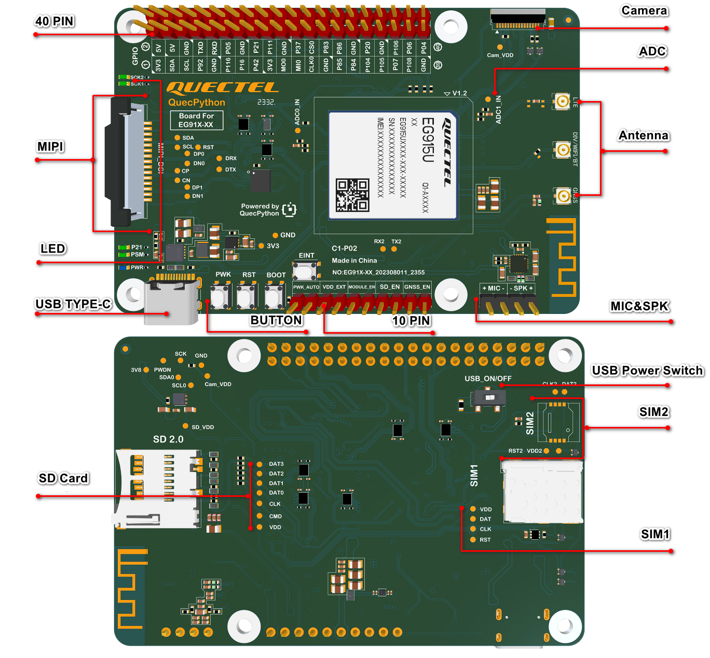
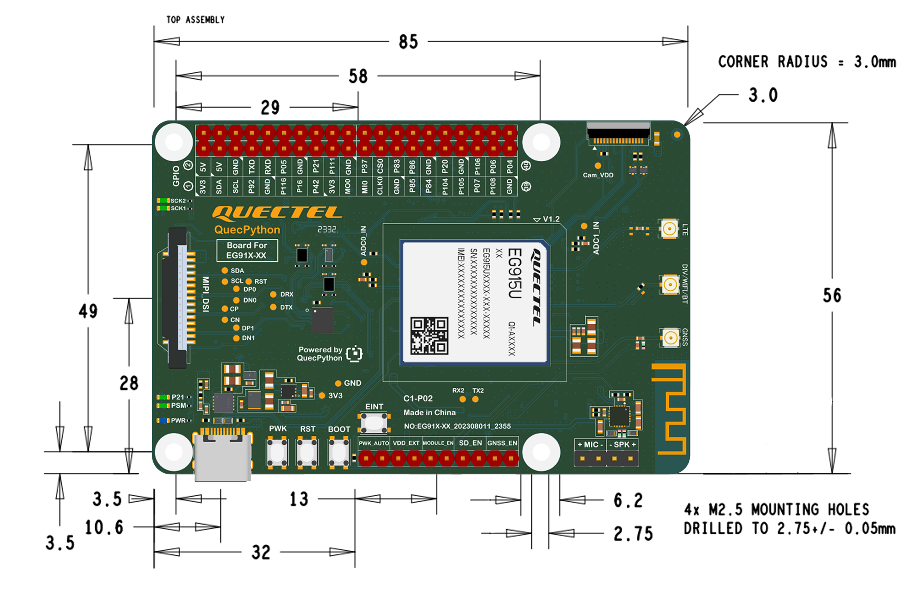
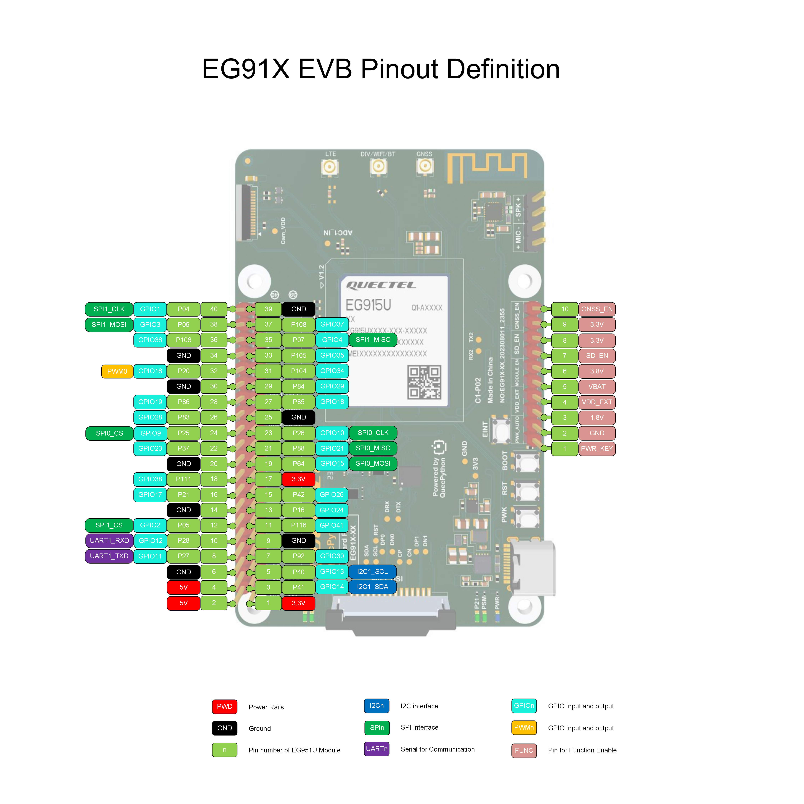
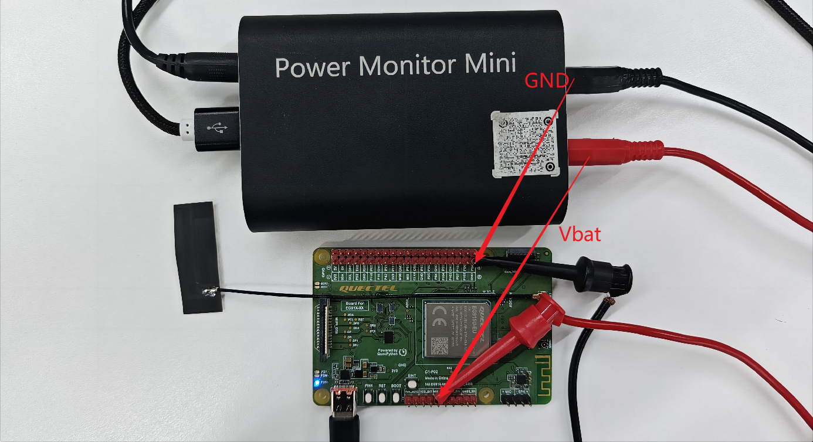
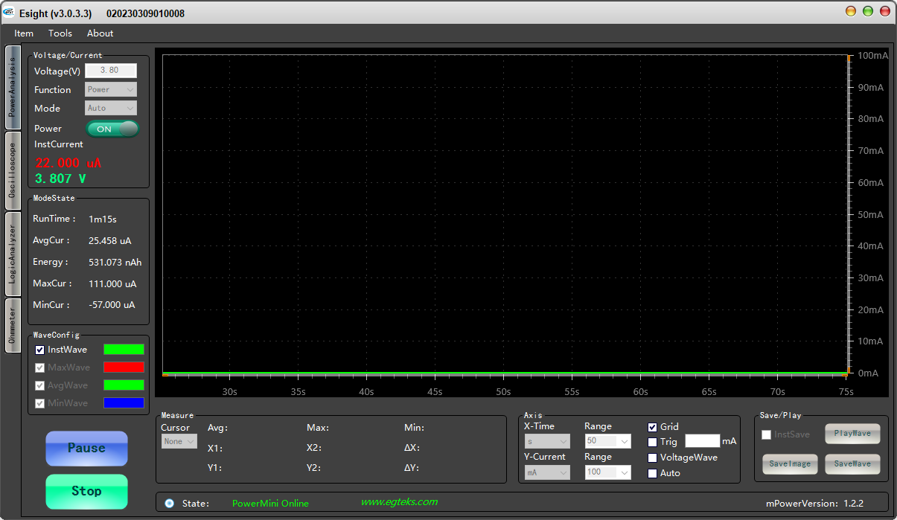
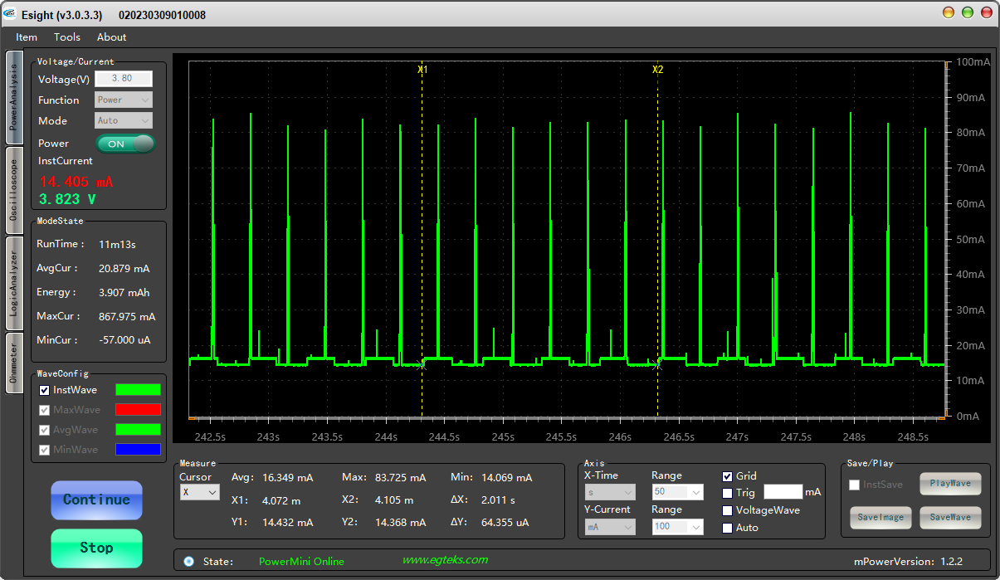
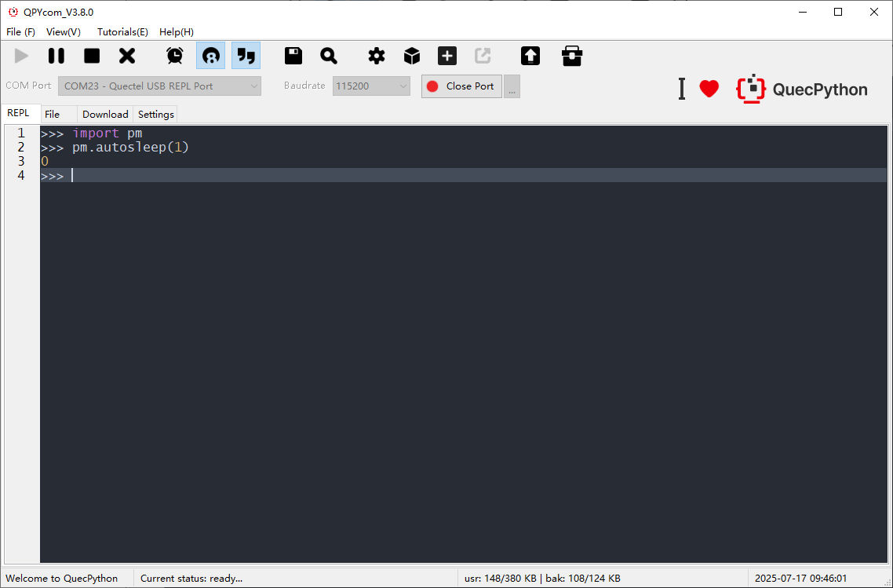
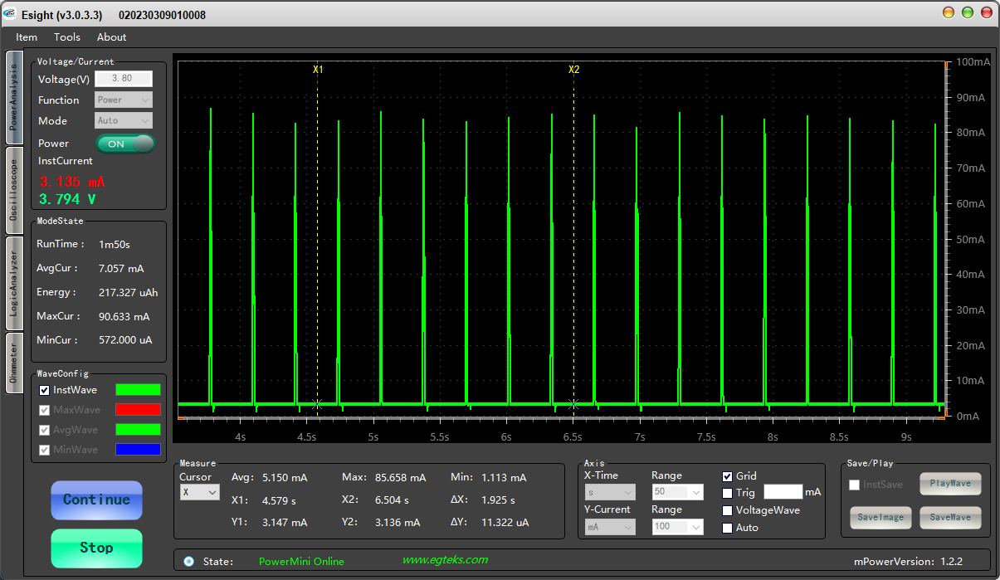
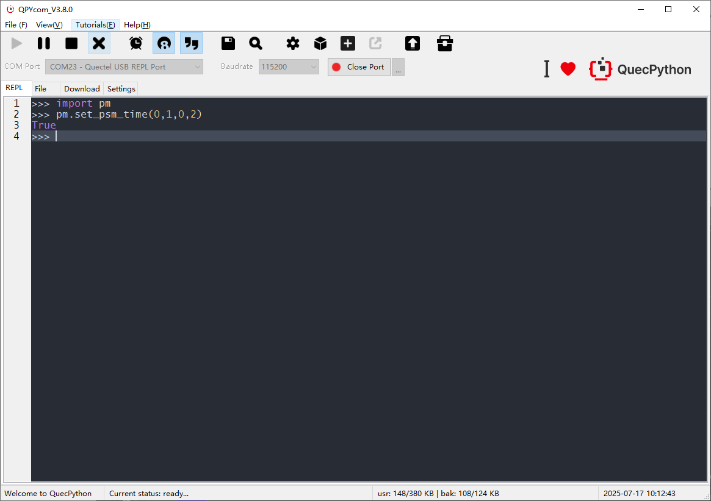
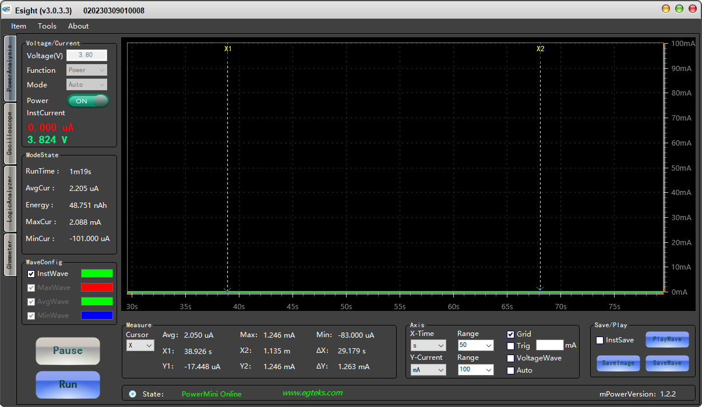

# Introduction to EG91X Evaluation Board

## Supported Module List

- [EG915U](https://developer.quectel.com/en/modules-cat/eg915u-series)


## Feature List

### Basic Overview

The QuecPython_EG91X series C1-P02 evaluation board is a compact and portable "pocket-sized" board designed specifically for QuecPython.

The main equipped modules are the EG915U series LTE Cat 1 wireless communication modules, which are also compatible with Quectel's EG91 series, EG95 series, BG95 series, and BG96 modules in terms of packaging. This allows for seamless switching between 2G and 4G networks to meet the application requirements of different industries.

The evaluation board has a built-in Type-C interface, making it convenient for development. Developers only need a USB Type-C cable to easily use the evaluation board.

Additionally, the evaluation board is compatible with the expansion board of Raspberry Pi Zero, which can be directly used on the evaluation board.


## Evaluation Board Resources

### Function Description

The main component and interface placement of the evaluation board is shown in the following figure:



Evaluation board dimensions:



The main pin placement of the evaluation board is shown in the following figure:



> **Note**
> For more information about the evaluation board, please visit <https://developer.quectel.com/en/resource-download?cid=252>.


### Evaluation Board Configuration

The detailed assignment of the peripheral interfaces on the evaluation board  is as follows:

| No.  | Name                    | Model        | Silkscreen                   | Comment                                                      |
| ---- | ----------------------- | ------------ | ---------------------------- | ------------------------------------------------------------ |
| 1    | USB Type-C Interface    | -            | -                            | -                                                            |
| 2    | SIM Card Slot 1         | SMN-315-ARP7 | SIM1                         | Nano-SIM                                                     |
| 3    | SIM Card Slot 2         | MUP-C7809-1  | SIM2                         | E-SIM                                                        |
| 4    | SD Card Slot            | TF-101A-P3   | SD 2.0                       | Before using the SD card, enable SD to provide power to the SD card in the 10-Pin Header. |
| 5    | USB Power Supply Switch | -            | USB_ON/OFF                   | When the switch is normally closed, Type-C supplies power to the module and evaluation board, and USB can be connected normally. When the USB switch is normally open, Type-C supplies power only to the evaluation board. In this case, the module is not powered. |
| 6    | MIPI Interface          | -            | MIPI_DSI                     | When the main module is EG91X series, it supports MIPI LCD and is fully compatible with Raspberry Pi peripherals. |
| 7    | Camera Interface        | -            | -                            | The evaluation board supports customized SPI cameras with a maximum of 300,000 pixels. |
| 8    | MIC&SPK   Interface     | AW8733A-     | +MIC-/-SPK+                  | -                                                            |
| 9    | 40-Pin Header           | -            | -                            | Onboard 40-Pin header; For details, see the above figure and table. |
| 10   | 10-Pin Header           | -            | -                            | Onboard 10-Pin header; For details, see the above figure and table. |
| 11   | ADC Interface           | -            | ADC1_IN                      | ADC testing interface                                        |
| 12   | PWK Botton              | -            | PWK                          | Turn-on button                                               |
| 13   | RST Button              | -            | RST                          | Reset button                                                 |
| 14   | BOOT Button             | -            | BOOT                         | Firmware burning button                                      |
| 15   | Antenna Interfaces      | -            | LTE<br/>DIV/WIFI/BT<br/>GNSS | LTE antenna connector<br/>DIV/Wi-Fi/Bluetooth antenna connector<br/>GNSS antenna connector |

**The evaluation board has 5 functional indication LEDs, as follows:**

- **P21**: Power indication LED.
- **PSM**: Module Pin 1, PSM indication LED.
- **SCK1**: SIM1 detection indication LED, lights up when SIM1 is inserted.
- **SCK2**: SIM2 detection indication LED, lights up when SIM2 is inserted.
- **PWR**: Power indication LED.

> The positions of the above indication LEDs refer to the silkscreen on the top of the evaluation board mentioned in the previous text (the side where the module is located is the top).


### Evaluation Board Interfaces

**Pin Assignment of 10-Pin Header**

| **Header** | **No.** | **Silk**screen | **Function** |
| ---------- | ------- | -------------- | ------------ |
| 10-Pin     | 1       | PWK_AUTO       | POWERKEY     |
| 10-Pin     | 2       | PWK_AUTO       | GND          |
| 10-Pin     | 3       | VDD_EXT        | 1.8 V        |
| 10-Pin     | 4       | VDD_EXT        | VDD_EXT      |
| 10-Pin     | 5       | MODULE_EN      | 3.8 V        |
| 10-Pin     | 6       | MODULE_EN      | 3.8 V        |
| 10-Pin     | 7       | SD_EN          | SD_EN        |
| 10-Pin     | 8       | SD_EN          | 3.3 V        |
| 10-Pin     | 9       | GNSS_EN        | 3.3 V        |
| 10-Pin     | 10      | GNSS_EN        | GNSS_EN      |

- **1 & 2**: Auto turn on
- **3 & 4**: Provide power externally when connected and test power consumption when disconnected
- **5 & 6**: Connect DCDC to power the module
- **7 & 8**: Enable SD power supply
- **9 & 10**: Enable GNSS active power supply

> When testing power consumption, make sure to switch off the USB power supply switch (USB_ON/OFF) on the back of the evaluation board.

**Singular-pin Assignment of 40-Pin Header**


|**No ** | **Name** | **Function Multiplexing**     	| **Function**                      	| **NO** | **Name** | **Function Multiplexing**    	| **Function**                      	|
| -------- | -------- | ------------------- | --------------------------------- | -------- | -------- | ------------------- | --------------------------------- |
| 1        | 3V3      | -                	| 3.3 V Output                     	| 2        | 5V       | -               	| 5 V Output                       	|
| 3        | SDA      | I2C1_SDA<br>GPIO14  | I2C1 Data<br>General Purpose Input/Output     	| 4        | 5V       | -               	| 5 V Output                      	|
| 5        | SCL      | I2C1_SCL<br>GPIO13  | I2C1 Clock<br>General Purpose Input/Output     	| 6        | GND      | -               	| Ground                          	|
| 7        | P92      | GPIO30           	| General Purpose Input/Output                  	| 8        | TXD      | UART1_TXD       	| UART1 Send                     	|
| 9        | GND      | -                	| Ground                          	| 10       | RXD      | UART1_RXD       	| UART1 Recv                     	|
| 11       | P116     | GPIO41           	| General Purpose Input/Output                  	| 12       | P05      | GPIO2<br>SPI1_CS	| General Purpose Input/Output<br>SPI1 Chip Select       	|
| 13       | P16      | GPIO24           	| General Purpose Input/Output                  	| 14       | GND      | -               	| Ground                          	|
| 15       | P42      | GPIO26           	| General Purpose Input/Output                  	| 16       | P21      | GPIO17          	| General Purpose Input/Output                  	|
| 17       | 3V3      | -                	| 3.3 V Output                     	| 18       | P111     | GPIO38          	| General Purpose Input/Output                  	|
| 19       | MO0      | SPI0_MOSI<br>GPIO15 | SPI0 Master Output Slave Input<br>General Purpose Input/Output 	| 20       | GND      | -               	| Ground                          	|
| 21       | MI0      | SPI0_MISO<br>GPIO21 | SPI0 Master Input Slave Output<br>General Purpose Input/Output 	| 22       | P37      | GPIO23          	| General Purpose Input/Output                  	|
| 23       | CLK0     | SPI0_CLK<br>GPIO10  | SPI0 Clock<br>General Purpose Input/Output         	| 24       | CS0      | SPI0_CS<br>GPIO9	| SPI0 Chip Select<br>General Purpose Input/Output      	|
| 25       | GND      | -                	| Ground                          	| 26       | P83      | GPIO28          	| General Purpose Input/Output                  	|
| 27       | P85      | GPIO18           	| General Purpose Input/Output                  	| 28       | P86      | GPIO19          	|General Purpose Input/Output                  		|
| 29       | P84      | GPIO29           	| General Purpose Input/Output                  	| 30       | GND      | -               	| Ground                          	|
| 31       | P104     | GPIO34           	| General Purpose Input/Output                  	| 32       | P20      | GPIO16<br>PWM0  	| General Purpose Input/Output<br>PWM0 Output      	|
| 33       | P105     | GPIO35           	| General Purpose Input/Output                  	| 34       | GND      | -               	| Ground                          	|
| 35       | P07      | GPIO04<br>SPI1_MISO | General Purpose Input/Output<br>SPI1 Master Input Slave Output  	| 36       | P106     | GPIO36          	| General Purpose Input/Output                  	|
| 37       | P108     | GPIO37           	| General Purpose Input/Output                  	| 38       | P06      | GPIO3<br>SPI1_MOSI 	| General Purpose Input/Output<br>SPI1 Master Output Slave Input	|
| 39       | GND      | -                 	| Ground                          	| 40       | P04      | GPIO1<br>SPI1_CLK  	| General Purpose Input/Output<br>SPI1 Clock      	|

## Quick Start Guide

### Hardware Preparation

- <font color='red'>**Step 1: Required Items**</font>

  - Development board
  - USB-C cable (A-to-C)
  - Windows 10 PC
  - Nano-SIM card
  - 4G antenna

- <font color='red'>**Step 2: Antenna & SIM Installation**</font>

  - Attach the provided antenna to the MAIN antenna port.
  - Insert the SIM card into the Nano-SIM slot.

- <font color='red'>**Step 3: Connect the Board**</font>

  - Power the board via USB-C.

- <font color='red'>**Step 4: Power On**</font>

  - Press and hold PWK until the power indicator light on the mainboard  (labeled as POW) lights up. 
  - If you short-circuited PWK_ON, there's no need to press PWK; the board will power on  automatically.

  > <font color='red'>**If the PWR indicator is constantly on, the EVB is successfully turned on.**</font>

### Driver Installation

1. Download the **QuecPython USB Driver** from [QuecPython Official Drivers](https://developer.quectel.com/en/resource-download?cid=2).
2. Extract and run `setup.exe` or `setup.bat`.
3. Verify installation in **Device Manager** (look for "Quectel USB" ports). Ignore unrelated devices like "Mobile ECM Network Adapter."

### Tool Installation

1. **QPYcom**: Download from [QuecPython Tools](https://developer.quectel.com/en/resource-download?cid=2). Extract and use directly.
2. **VSCode Plugin**: Search for "QuecPython" in the Visual Studio Code marketplace.

### Firmware Burning

1. **Firmware Download**: Get the latest QuecPython firmware  from QuecPython Firmware Page.

2. **Burning Steps**:

   - Open QPYcom, select the USB REPL port, and create a new project.

   - Choose the `.bin` firmware file
   - Set mode to "Download FW" and click **Download**.


### REPL Debugging

1. Connect via QPYcom and open the REPL interface.
2. Test with `print("Hello World!")`.


## First Script Development

### Writing a Script

Create `helloworld.py`:

```python
print("Hello World!")
```

### File Transfer

- **Method 1**: Drag-and-drop files via QPYcom’s GUI.


- **Method 2**: Use the "Download Script" feature in QPYcom.


### Running Scripts

Execute via REPL:

```python
import example
example.exec("/usr/helloworld.py")
```

### Stopping Program Execution

How to stop a running program. The following methods are provided according to the type of the running script file:

| Is the program name main.py? | Does the program contain a dead loop? | Does the program use multiple threads? | Stopping Steps                                               |
| :--------------------------: | :-----------------------------------: | :------------------------------------: | :----------------------------------------------------------- |
|              ✓               |                   ✓                   |                   ✓                    | (1) Press Ctrl + A to enter RAW mode <br />(2) Press Ctrl + D to restart the QuePython virtual machine <br />(3) Press Ctrl + B to return to the normal interactive mode<br />(4) If the above methods fail, re-flash the firmware |
|              ✓               |                   ✓                   |                   ✗                    | (1) Press Ctrl + C to interrupt the program execution <br />(2) If the above method fails, re-flash the firmware |
|              ✓               |                   ✗                   |                   ✓                    | (1) Press Ctrl + A to enter RAW mode <br />(2) Press Ctrl + D to restart the QuePython virtual machine <br />(3) Press Ctrl + B to return to the normal interactive mode <br />(4) If the above methods fail, wait for the program to finish running |
|              ✓               |                   ✗                   |                   ✗                    | (1) Press Ctrl + C to interrupt the program execution <br />(2) If the above method fails, re-flash the firmware |
|              ✗               |                   ✓                   |                   ✓                    | (1) Press Ctrl + D to restart the QuePython virtual machine <br />(2) If the above method fails, directly restart the module |
|              ✗               |                   ✓                   |                   ✗                    | (1) Press Ctrl + D to restart the QuePython virtual machine <br />(2) If the above method fails, directly restart the module |
|              ✗               |                   ✗                   |                   ✓                    | (1) Press Ctrl + C to interrupt the program execution <br />(2) If the above method fails, re-flash the firmware or directly restart the module |
|              ✗               |                   ✗                   |                   ✗                    | (1) Press Ctrl + C to interrupt the program execution <br />(2) If the above method fails, re-flash the firmware or directly restart the module |

## Low Power Consumption Testing Guide

The EG915U module supports multiple operating modes, each with distinct power consumption characteristics. The common operating modes are as follows:

**ACTIVE**: The module is engaged in LTE data transmission, GSM calls, or executing RTOS logic. Power consumption varies significantly depending on specific tasks and network communication standards, as both CPU power usage and RF power levels differ across scenarios.

**IDLE**: The module is in an idle state with hardware fully powered and RTOS running, but no active threads. It resumes operation immediately upon task initiation or incoming network activity. ECX00U series modules reduce clock frequency in IDLE mode, entering a light sleep state (disabling high-speed clocks while keeping the CPU active).

**Sleep**: Sleep mode requires the module to be idle with autosleep enabled. In this mode, RTOS pauses, clock frequency slows, and peripheral controllers (UART, SPI, etc.) are powered down, retaining only essential interrupt controllers to minimize power consumption.

**PSM**: PSM (Power Saving Mode) is a 3GPP-defined low-power mode where the module periodically wakes to perform tasks and remains in PSM sleep otherwise. During PSM sleep, behavior and power consumption resemble a powered-off state.

**Power Off**: The module is fully powered down, with baseband chips and peripheral controllers disabled (PMIC remains active). It can be awakened via Powerkey or RTC alarm.

| Module Model         | EG915U  |
| :------------------- | :------ |
| IDLE (LTE FDD@64ms)  | 13.0 mA |
| SLEEP (LTE FDD@64ms) | 1.8 mA  |
| SLEEP (CFUN0)        | 1.0 mA  |
| Power Off            | 32 μA   |

### Test Preparation

- <font color='red'>**Step 1: Hardware Setup**</font>

  Prepare the following components before starting:

  1. **Development Board**  
  2. **USB Cable** (USB-A to USB-TypeC)  
  3. **PC** (Windows 10)  
  4. **SIM Card**  
  5. **4G Antenna**  
  6. **Power Monitor Mini**  

- <font color='red'>**Step 2: Antenna & SIM Card Installation**</font>

  Install the provided antenna into the MAIN antenna socket and insert the SIM card into the development board's SIM slot.

- <font color='red'>**Step 3: Board Connection**</font>

  Connect the development board's Type-C port to the PC using a USB Type-C cable. Attach the power monitor's positive lead to MODULE_EN's Vbat (refer to [BG95 User Guide](https://developer.quectel.com/en/wp-content/uploads/sites/2/2026/04/QuecPython_BG95-XX_Zero_EVB_Specification_and_User_Guide_V1.0.0_Preliminary_20240130.pdf)) and the negative lead to the module's GND. Connection diagram:

  

  > **Important!**  
  > Remove all jumper caps during measurements to avoid external interference.  

### Power Consumption Measurement

#### Power-Off Current

With the board connected via USB Type-C, power off the module by disabling USB_VBus (set USB switch to "off" on the board's rear). Measure the current while the module is inactive (output pins pulled low/floating). Average current remains stable at microampere levels.

  

#### Idle Current

After power-off measurement, press and hold Powerkey to boot the module (default: IDLE mode). The module remains idle with RTOS running but no active threads, ready to resume instantly for tasks or calls.

 

#### Sleep Current

With autosleep enabled during idle, the module enters sleep mode by deactivating non-essential IP cores (peripherals/interrupts) and reducing clock frequency.

1. Re-enable USB_VBus.  

2. Open [QPYcom Tool](https://developer.quectel.com/wp-content/uploads/2024/09/QPYcom_V3.8.0.zip) and execute:  

   ```python
   import pm
   pm.autosleep(1)  # Enable autosleep
   ```

   

3. Disable USB_VBus again (switch to "off").
   [API Reference](https://developer.quectel.com/doc/quecpython/API_reference/en/syslib/pm.html) | [Details](https://developer.quectel.com/doc/quecpython/Application_guide/en/system/power-consumption.html)

4. Sleep current shows periodic spikes:
   

#### PSM Current

To enable PSM:

1. Request PSM from the base station (via ATTACH/TA_UPDATER with timer parameters).
   - Note: Base station determines final timer values.
2. Once ACT timer expires in IDLE, the module shuts down CPU/RF (partial power-off), retaining wake-up sources (ACT/TAU timers, PSM_INT).

Steps:

1. Enable USB_VBus.

2. In QPYcom:

   ```python
   pm.set_psm_time(tau_uint,tau_time,act_uint,act_time)   # Configure PSM
   ```

   

3. Disable USB_VBus.
   [PSM Guide](https://developer.quectel.com/doc/quecpython/Application_guide/en/system/power-consumption.html) | [API](https://developer.quectel.com/doc/quecpython/API_reference/en/syslib/pm.html)

PSM baseline current (µA-level, similar to power-off):


> **Notes:**
>
> - Confirm carrier support for PSM and configure compatible network standards (this test uses catM).
> - [Additional guidance](https://developer.quectel.com/doc/quecpython/Application_guide/en/system/power-consumption.html).