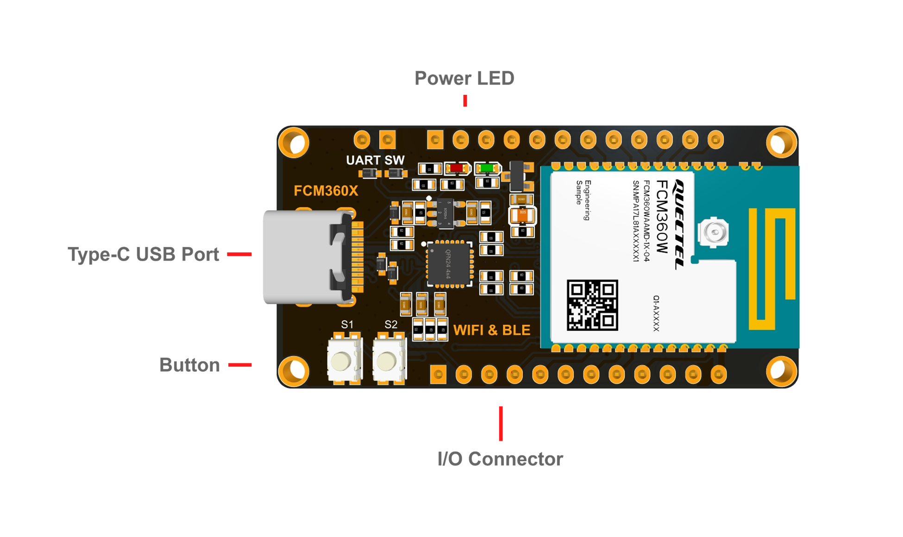
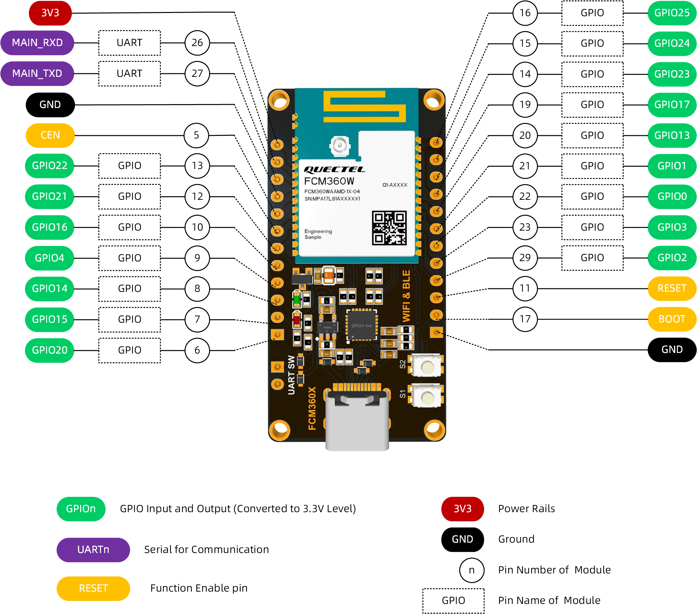

# FCM360W EVB Introduction

## Supported Modules

Supported module model

- [FCM360W](https://www.quectel.com.cn/product/wi-fi-bluetooth-fcm360w)

## Feature List

### Basic Overview

The QuecPython_FCM360W_EVB development board is a compact and portable "pocket-sized" board designed specifically for QuecPython. It features a Type-C interface, allowing developers to easily use the board with just a USB Type-C data cable.

### Feature Description

The main components and interface layout of the EVB are shown in the figure below.



## Document download

- [FCM360X_EVB_SCH](https://developer.quectel.com/en/wp-content/uploads/sites/2/2024/11/FCM360X-EVB-V1.3-SCH.pdf)

## EVB Resources

### EVB Interface

**J1 Pin Assignment**

| Pin Header | Pin No. | Name     | Feature               |
| ---------- | ------- | -------- | --------------------- |
| J1         | -       | VCC_3V3  | 3.3 V                 |
| J1         | 26      | MAIN_RXD | UART0                 |
| J1         | 27      | MAIN_TXD | UART0                 |
| J1         | -       | GND      | Ground                |
| J1         | 5       | CEN      | Module enable control |
| J1         | 13      | IO22     | GPIO22                |
| J1         | 12      | IO21     | GPIO21                |
| J1         | 10      | IO16     | GPIO16                |
| J1         | 9       | IO4      | GPIO4                 |
| J1         | 8       | IO14     | GPIO14                |
| J1         | 7       | IO15     | GPIO15                |
| J1         | 6       | IO20     | GPIO20                |

**J2 Pin Assignment**

| Pin Header | Pin No. | Name  | Feature              |
| ---------- | ------- | ----- | -------------------- |
| J2         | 16      | IO25  | GPIO25               |
| J2         | 15      | IO24  | GPIO24               |
| J2         | 14      | IO23  | GPIO23               |
| J2         | 19      | IO17  | GPIO17               |
| J2         | 20      | IO13  | GPIO13               |
| J2         | 21      | IO1   | GPIO1                |
| J2         | 22      | IO0   | GPIO0                |
| J2         | 23      | IO3   | GPIO3                |
| J2         | 29      | IO2   | GPIO2                |
| J2         | 11      | RESET | Module reset control |
| J2         | 17      | BOOT  | Module boot control  |
| J2         | -       | GND   | Ground               |

The following figure shows the pin assignment.



> **Tips**
>
> For more information about the EVB, please visit [QuecPython Download](https://www.quectel.com.cn/download-zone)

### EVB Configuration

The pins of peripherals are shown in the table below.

| No.  | Name        | Model  | Supported | Interface Type | Pin       |
| ---- | ----------- | ------ | --------- | -------------- | --------- |
| 1    | USB to UART | CH340N | Yes       | USB            | 26 and 27 |
| 2    | Key         | -      | Yes       | GPIO           | 15 and 16 |

## Quick Start Guide

### Hardware Preparation

- <font color='red'>**Step 1: Required Items**</font>

  - Development board
  - USB-C cable (A-to-C)
  - Windows 10 PC
  - Nano-SIM card
  - 4G antenna

- <font color='red'>**Step 2: Antenna & SIM Installation**</font>

  - Attach the provided antenna to the MAIN antenna port.
  - Insert the SIM card into the Nano-SIM slot.

- <font color='red'>**Step 3: Connect the Board**</font>

  - Power the board via USB-C.

- <font color='red'>**Step 4: Power On**</font>

  - Press and hold PWK until the power indicator light on the mainboard  (labeled as POW) lights up. 
  - If you short-circuited PWK_ON, there's no need to press PWK; the board will power on  automatically.

  > <font color='red'>**If the PWR indicator is constantly on, the EVB is successfully turned on.**</font>

### Driver Installation

1. Download the **QuecPython USB Driver** from [QuecPython Official Drivers](https://www.quectel.com.cn/download-zone).
2. Extract and run `setup.exe` or `setup.bat`.
3. Verify installation in **Device Manager** (look for "Quectel USB" ports). Ignore unrelated devices like "Mobile ECM Network Adapter."

### Tool Installation

1. **QPYcom**: Download from [QuecPython Tools](https://www.quectel.com.cn/download-zone). Extract and use directly.
2. **VSCode Plugin**: Search for "QuecPython" in the Visual Studio Code marketplace.

### Firmware Burning

1. **Firmware Download**: Get the latest QuecPython firmware  from QuecPython Firmware Page.

2. **Burning Steps**:

   - Open QPYcom, select the USB REPL port, and create a new project.

   - Choose the `.bin` firmware file
   - Set mode to "Download FW" and click **Download**.


### REPL Debugging

1. Connect via QPYcom and open the REPL interface.
2. Test with `print("Hello World!")`.


## First Script Development

### Writing a Script

Create `helloworld.py`:

```python
print("Hello World!")
```

### File Transfer

- **Method 1**: Drag-and-drop files via QPYcom’s GUI.


- **Method 2**: Use the "Download Script" feature in QPYcom.


### Running Scripts

Execute via REPL:

```python
import example
example.exec("/usr/helloworld.py")
```

### Stopping Program Execution

How to stop a running program. The following methods are provided according to the type of the running script file:

| Is the program name main.py? | Does the program contain a dead loop? | Does the program use multiple threads? | Stopping Steps                                               |
| :--------------------------: | :-----------------------------------: | :------------------------------------: | :----------------------------------------------------------- |
|              ✓               |                   ✓                   |                   ✓                    | (1) Press Ctrl + A to enter RAW mode <br />(2) Press Ctrl + D to restart the QuePython virtual machine <br />(3) Press Ctrl + B to return to the normal interactive mode<br />(4) If the above methods fail, re-flash the firmware |
|              ✓               |                   ✓                   |                   ✗                    | (1) Press Ctrl + C to interrupt the program execution <br />(2) If the above method fails, re-flash the firmware |
|              ✓               |                   ✗                   |                   ✓                    | (1) Press Ctrl + A to enter RAW mode <br />(2) Press Ctrl + D to restart the QuePython virtual machine <br />(3) Press Ctrl + B to return to the normal interactive mode <br />(4) If the above methods fail, wait for the program to finish running |
|              ✓               |                   ✗                   |                   ✗                    | (1) Press Ctrl + C to interrupt the program execution <br />(2) If the above method fails, re-flash the firmware |
|              ✗               |                   ✓                   |                   ✓                    | (1) Press Ctrl + D to restart the QuePython virtual machine <br />(2) If the above method fails, directly restart the module |
|              ✗               |                   ✓                   |                   ✗                    | (1) Press Ctrl + D to restart the QuePython virtual machine <br />(2) If the above method fails, directly restart the module |
|              ✗               |                   ✗                   |                   ✓                    | (1) Press Ctrl + C to interrupt the program execution <br />(2) If the above method fails, re-flash the firmware or directly restart the module |
|              ✗               |                   ✗                   |                   ✗                    | (1) Press Ctrl + C to interrupt the program execution <br />(2) If the above method fails, re-flash the firmware or directly restart the module |