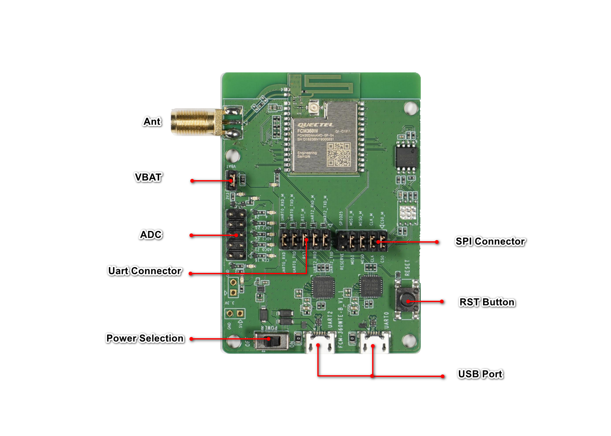

# Introduction to FCM360W te-b development board

## Supported module list

- [FCM360W](https://developer.quectel.com/en/modules-cat/fcm360w-series)

## Function list

### Basic overview

QuecPython_FCM360W_TE-B development board is a Wi-Fi and Bluetooth development board launched by Quectel. Equipped with FCM360W module, it supports Wi-Fi 6 and Bluetooth 5.1 wireless connections, and provides large memory including 512 KB SRAM and 4MB flash memory.

The development board connection interface is two micro-usb interfaces, and provides a variety of interfaces, including UART, SPI, I2C, ADC, etc. The supporting antennas include external pin antennas, PCB antennas, etc.

### Functional Description

The main components and interface layout of the development board are shown in the figure below



## Download

- [FCM360X_EVB_SCH](https://developer.quectel.com/en/wp-content/uploads/sites/2/2024/11/FCM360X-EVB-V1.0-SCH.pdf)

- [Quectel_FCM360W_Hardware Design Manual](https://developer.quectel.com/en/wp-content/uploads/sites/2/2024/11/Quectel_FCM360W_Hardware_Design_V1.0.pdf)

## Development Board Resources

### Development board interface

The main pin layout of the development board is shown in the table below

| **Pin header** | **Name** | **Pin** | **Function** |
| -------- | -------- | -------- | -------- |
| UART | UART0_RXD | 26 | UART0 receive |
| UART | UART0_TXD | 27 | UART0 send |
| UART | RST | 11 | Module reset |
| UART | UART2_RXD | 19 | UART2 receive |
| UART | UART2_TXD | 20 | UART2 send |
| UART | UART0_RXD_M | 26 | UART0 |
| UART | UART0_TXD_M | 27 | UART0 |
| UART | RST_M | 11 | Module reset |
| UART | UART2_RXD_M | 19 | UART2 |
| UART | UART2_TXD_M | 20 | UART2 |
| SPI | RESERVE | 17 | Reserved |
| SPI | MOSI | 29 | SPI Master Output Slave Input |
| SPI | MISO | 23 | SPI Master Input Slave Output |
| SPI | CLK | 22 | SPI Clock |
| SPI | CS0 | 21 | SPI Chip Select |
| SPI | GPIO25 | 16 | GPIO25 |
| SPI | MOSI_M | 29 | SPI Master Output Slave Input |
| SPI | MISO_M | 23 | SPI Master Input Slave Output |
| SPI | CLK_M | 22 | SPI Clock |
| SPI | CS0_M | 21 | SPI Chip Select |

- **The pins with _M in the name are directly connected to the module end**

> **Tips**
> For more information about the development board, please visit <https://developer.quectel.com/en/resource-download?cid=252>

### Development board configuration

The peripheral resource pin allocation table is as follows:

| Serial number | Name | Model | Supported | Interface type |
| ---- | --------- | ------ | -------- | -------- |
| 1 | USB to serial port | CP2102 | Yes | UART |
| 2 | Button | - | Yes | GPIO |
| 2 | ANT | - | Yes | - |

## Quick Start Guide

### Hardware Preparation

- <font color='red'>**Step 1: Required Items**</font>

  - Development board
  - USB-C cable (A-to-C)
  - Windows 10 PC
  - Nano-SIM card
  - 4G antenna

- <font color='red'>**Step 2: Antenna & SIM Installation**</font>

  - Attach the provided antenna to the MAIN antenna port.
  - Insert the SIM card into the Nano-SIM slot.

- <font color='red'>**Step 3: Connect the Board**</font>

  - Power the board via USB-C.

- <font color='red'>**Step 4: Power On**</font>

  - Press and hold PWK until the power indicator light on the mainboard  (labeled as POW) lights up. 
  - If you short-circuited PWK_ON, there's no need to press PWK; the board will power on  automatically.

  > <font color='red'>**If the PWR indicator is constantly on, the EVB is successfully turned on.**</font>

### Driver Installation

1. Download the **QuecPython USB Driver** from [QuecPython Official Drivers](https://developer.quectel.com/en/resource-download?cid=2).
2. Extract and run `setup.exe` or `setup.bat`.
3. Verify installation in **Device Manager** (look for "Quectel USB" ports). Ignore unrelated devices like "Mobile ECM Network Adapter."

### Tool Installation

1. **QPYcom**: Download from [QuecPython Tools](https://developer.quectel.com/en/resource-download?cid=2). Extract and use directly.
2. **VSCode Plugin**: Search for "QuecPython" in the Visual Studio Code marketplace.

### Firmware Burning

1. **Firmware Download**: Get the latest QuecPython firmware  from QuecPython Firmware Page.

2. **Burning Steps**:

   - Open QPYcom, select the USB REPL port, and create a new project.

   - Choose the `.bin` firmware file
   - Set mode to "Download FW" and click **Download**.


### REPL Debugging

1. Connect via QPYcom and open the REPL interface.
2. Test with `print("Hello World!")`.


## First Script Development

### Writing a Script

Create `helloworld.py`:

```python
print("Hello World!")
```

### File Transfer

- **Method 1**: Drag-and-drop files via QPYcom’s GUI.


- **Method 2**: Use the "Download Script" feature in QPYcom.


### Running Scripts

Execute via REPL:

```python
import example
example.exec("/usr/helloworld.py")
```

### Stopping Program Execution

How to stop a running program. The following methods are provided according to the type of the running script file:

| Is the program name main.py? | Does the program contain a dead loop? | Does the program use multiple threads? | Stopping Steps                                               |
| :--------------------------: | :-----------------------------------: | :------------------------------------: | :----------------------------------------------------------- |
|              ✓               |                   ✓                   |                   ✓                    | (1) Press Ctrl + A to enter RAW mode <br />(2) Press Ctrl + D to restart the QuePython virtual machine <br />(3) Press Ctrl + B to return to the normal interactive mode<br />(4) If the above methods fail, re-flash the firmware |
|              ✓               |                   ✓                   |                   ✗                    | (1) Press Ctrl + C to interrupt the program execution <br />(2) If the above method fails, re-flash the firmware |
|              ✓               |                   ✗                   |                   ✓                    | (1) Press Ctrl + A to enter RAW mode <br />(2) Press Ctrl + D to restart the QuePython virtual machine <br />(3) Press Ctrl + B to return to the normal interactive mode <br />(4) If the above methods fail, wait for the program to finish running |
|              ✓               |                   ✗                   |                   ✗                    | (1) Press Ctrl + C to interrupt the program execution <br />(2) If the above method fails, re-flash the firmware |
|              ✗               |                   ✓                   |                   ✓                    | (1) Press Ctrl + D to restart the QuePython virtual machine <br />(2) If the above method fails, directly restart the module |
|              ✗               |                   ✓                   |                   ✗                    | (1) Press Ctrl + D to restart the QuePython virtual machine <br />(2) If the above method fails, directly restart the module |
|              ✗               |                   ✗                   |                   ✓                    | (1) Press Ctrl + C to interrupt the program execution <br />(2) If the above method fails, re-flash the firmware or directly restart the module |
|              ✗               |                   ✗                   |                   ✗                    | (1) Press Ctrl + C to interrupt the program execution <br />(2) If the above method fails, re-flash the firmware or directly restart the module |